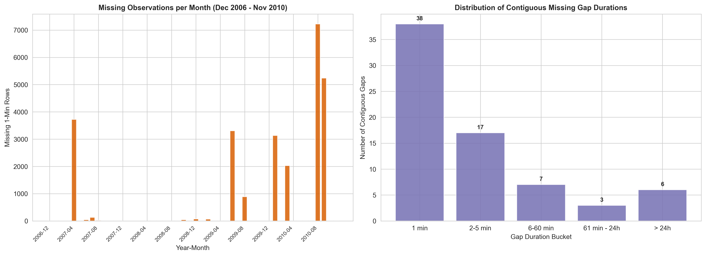
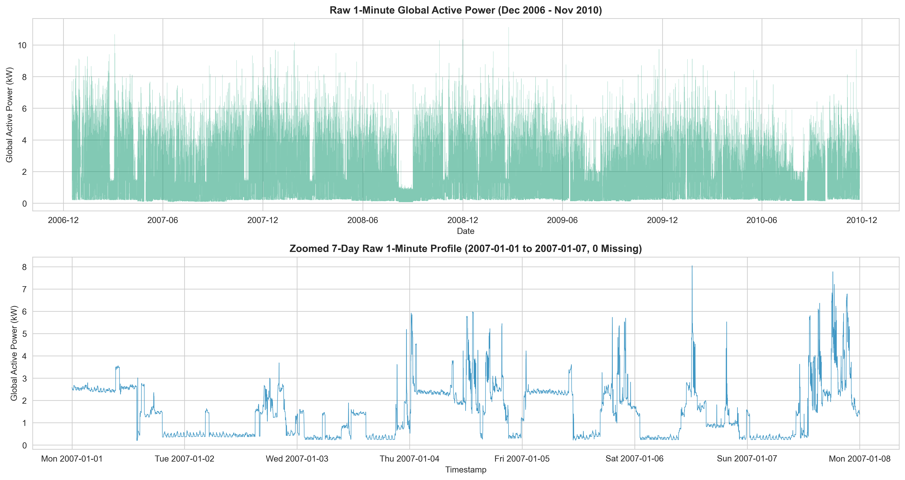
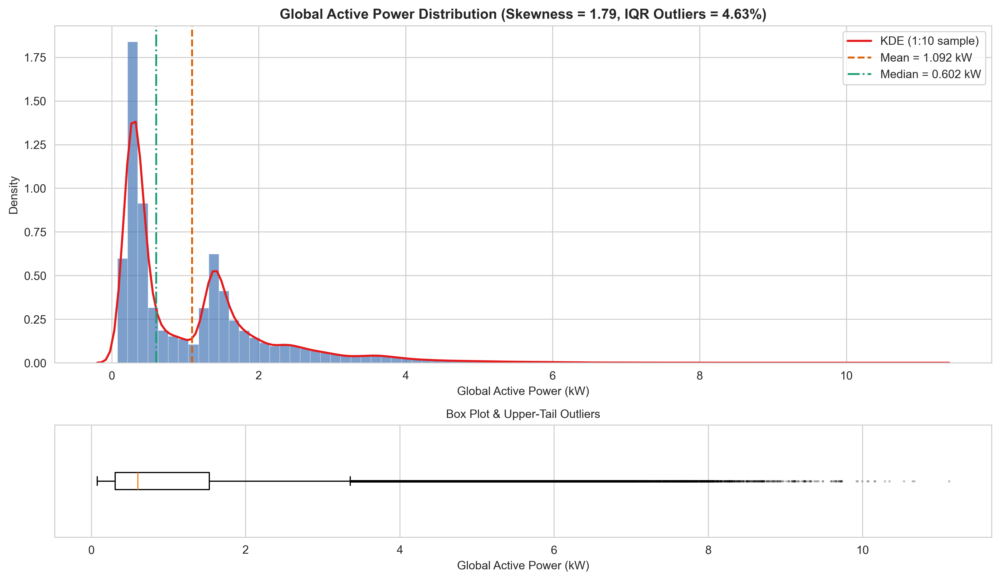
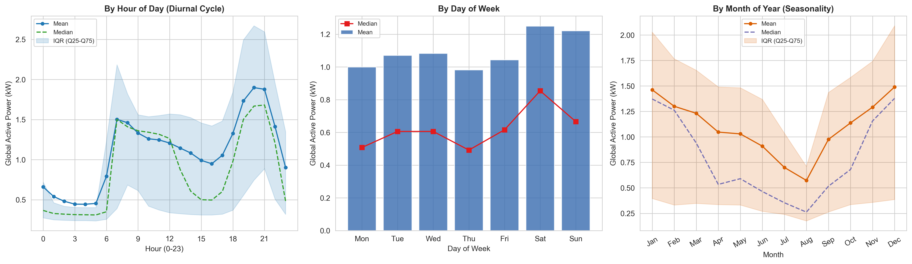
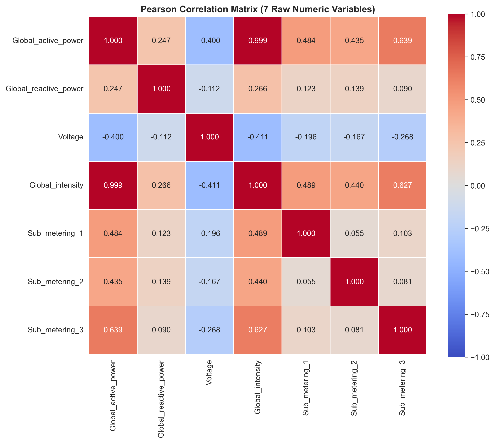
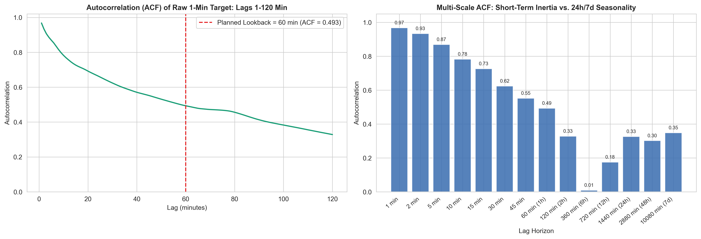

# Laporan Exploratory Data Analysis (EDA) Awal — Household Electric Power Consumption

**Tanggal Analisis:** 2026-11-25  
**Target Forecasting:** `Global_active_power` (kW) — Time Series Regression  
**Rencana Arsitektur:** Stacked LSTM (`lookback = 60` time steps)  
**Lingkungan Eksekusi:** Windows 11, Intel Core i5-1235U, RAM 24 GB (CPU-only), Python 3.10.6  
**Skrip EDA:** `src/eda_initial.py` | **Metrik Terukur:** `reports/eda_metrics.json`

---

## 1. Audit Environment & Kompatibilitas TensorFlow

Seluruh dependensi proyek diinstal secara terisolasi pada virtual environment khusus proyek (`.venv`) tanpa memodifikasi instalasi Python global (`C:\laragon\bin\python\python-3.10\python.exe`).

| Komponen | Hasil Verifikasi (`.venv`) | Catatan |
| :--- | :--- | :--- |
| **Python** | `3.10.6` (64-bit AMD64) | Terisolasi di `.venv\Scripts\python.exe` |
| **TensorFlow** | `2.21.0` (Keras `3.12.4`) | Kompatibel penuh dengan Python 3.10.6 pada Windows CPU (`oneDNN` aktif) |
| **Perangkat Komputasi** | `[PhysicalDevice(name='/physical_device:CPU:0', device_type='CPU')]` | Native Windows GPU tidak didukung untuk TensorFlow $\ge 2.11$; operasi tensor CPU (`tf.reduce_sum`) terverifikasi sukses (`6.0`) |
| **Library Pendukung** | `pandas 2.3.3`, `numpy 2.2.6`, `scikit-learn 1.7.2`, `scipy 1.15.3`, `matplotlib 3.10.9`, `seaborn 0.13.2`, `tabulate 0.10.0` | `pip check`: *No broken requirements found* |

---

## 2. Integritas & Struktur Dataset Mentah

Dataset diunduh langsung dari sumber resmi UCI Machine Learning Repository (`id=235`):
- **Arsip ZIP:** `data/raw/individual+household+electric+power+consumption.zip` (`20.640.916` bytes, `SHA-256: 9f84b46ade8a2d8e1286ec4b2b6c2987a45a755c59f263be3b3b3d10dfbda3ff`, `zipfile.testzip() == None`)
- **File Mentah:** `data/raw/household_power_consumption.txt`
- **Ukuran File:** `132.960.755` bytes (`126,80 MB`)
- **SHA-256 (Sebelum & Sesudah EDA):** `4259c9d7ece5dbee9ab8d53682baac68d791c864f0f64a52b4043cb3b90894b7` *(identik — data mentah tidak dimodifikasi)*
- **Encoding & Format:** `ASCII (valid UTF-8)`, tanpa UTF-8 BOM, *line ending* `CRLF (\r\n)`, delimiter titik koma (`;`)
- **Jumlah Baris:** `2.075.260` baris fisik (`1` baris header + `2.075.259` baris observasi)
- **Jumlah Kolom:** `9` kolom (`Date`, `Time`, `Global_active_power`, `Global_reactive_power`, `Voltage`, `Global_intensity`, `Sub_metering_1`, `Sub_metering_2`, `Sub_metering_3`)

### Skema Kolom & Tipe Data Mentah

Ketika file dibaca mentah dengan `pandas.read_csv(..., sep=';', low_memory=False)` tanpa parameter `na_values`:

| Kolom | Tipe Data Mentah | Tipe Target Analisis | Satuan / Keterangan | Jumlah Token `?` | Nilai Kosong (`""`) |
| :--- | :--- | :--- | :--- | ---: | ---: |
| `Date` | `object` | `datetime64[ns]` (gabungan) | Format `dd/mm/yyyy` | 0 | 0 |
| `Time` | `object` | `datetime64[ns]` (gabungan) | Format `hh:mm:ss` | 0 | 0 |
| `Global_active_power` | `object` | `float64` | Kilowatt (kW) — **Target** | 25.979 | 0 |
| `Global_reactive_power` | `object` | `float64` | Kilowatt (kVAR / kW reaktif) | 25.979 | 0 |
| `Voltage` | `object` | `float64` | Volt (V) | 25.979 | 0 |
| `Global_intensity` | `object` | `float64` | Ampere (A) | 25.979 | 0 |
| `Sub_metering_1` | `object` | `float64` | Watt-hour (dapur) | 25.979 | 0 |
| `Sub_metering_2` | `object` | `float64` | Watt-hour (laundry) | 25.979 | 0 |
| `Sub_metering_3` | `float64` | `float64` | Watt-hour (water heater & AC) | 0 | 25.979 |

> **Temuan Teknis Format:** Pada baris yang hilang (contoh baris `6841`: `21/12/2006;11:23:00;?;?;?;?;?;?;`), 6 kolom pengukuran pertama memakai karakter `?`, sedangkan kolom terakhir `Sub_metering_3` berupa field kosong setelah `;` sehingga langsung terbaca sebagai `NaN` bertipe `float64`. Selain `?` dan field kosong pada baris tersebut, tidak ada token non-numerik lain.

---

## 3. Pemeriksaan Kualitas Data (Missing Values, Gap, & Kontinuitas Waktu)

### 3.1 Kontinuitas Timestamp & Duplikasi
- **Rentang Waktu:** `2006-12-16 17:24:00` s.d. `2010-11-26 21:02:00` (`1.441,15` hari / ~47,3 bulan)
- **Kesesuaian Grid 1-Menit:** Jumlah baris aktual (`2.075.259`) **sama persis** dengan jumlah menit inklusif antara `min_datetime` dan `max_datetime` (`2.075.259` slot 1-menit).
- **Monotonisitas:** `is_monotonic_increasing == True`. Seluruh `2.075.258` selisih waktu antar baris berurutan bernilai tepat `60 detik` (`0` timestamp lompat).
- **Duplikasi:** `0` duplicate timestamps dan `0` duplicate full rows.

### 3.2 Missing Values & Analisis Gap Kontigu
- **Total Baris Missing:** `25.979` dari `2.075.259` baris (**`1,2518%`**).
- **Pola Serentak:** `always_missing_simultaneously_across_7_cols == True` — setiap kali data sensor hilang pada suatu menit, **ketujuh kolom pengukuran hilang secara bersamaan**.
- **Jumlah Gap Kontigu:** Terdapat **`71` blok gap kontigu** dengan panjang minimum `1 menit`, median `1 menit`, Q75 `3 menit`, rata-rata `365,90 menit`, dan maksimum `7.226 menit` (`5,02 hari`).

**Distribusi Panjang Gap Kontigu:**

| Kategori Durasi Gap | Jumlah Blok Gap | Persentase Blok | Keterangan |
| :--- | ---: | ---: | :--- |
| `1 min` | 38 | 53,5% | Mayoritas berupa dropout sesaat 1 menit |
| `2–5 min` | 17 | 23,9% | Gap sangat pendek |
| `6–60 min` | 7 | 9,9% | Gap pendek hingga 1 jam (maks di kategori ini: 47 menit) |
| `61 min – 24h` | 3 | 4,2% | Gap menengah (70 menit, 83 menit, dan 891 menit / 14,85 jam) |
| `> 24h` | 6 | 8,5% | Gap panjang multi-hari (1,41 hari hingga 5,02 hari) |

**10 Blok Gap Kontigu Terpanjang:**

| Peringkat | Mulai | Selesai | Durasi (Menit) | Durasi (Jam / Hari) |
| :---: | :--- | :--- | ---: | :--- |
| 1 | `2010-08-17 21:02:00` | `2010-08-22 21:27:00` | 7.226 | 120,43 jam (`5,02 hari`) |
| 2 | `2010-09-25 03:56:00` | `2010-09-28 19:12:00` | 5.237 | 87,28 jam (`3,64 hari`) |
| 3 | `2007-04-28 00:21:00` | `2007-04-30 14:23:00` | 3.723 | 62,05 jam (`2,59 hari`) |
| 4 | `2009-06-13 00:30:00` | `2009-06-15 07:34:00` | 3.305 | 55,08 jam (`2,30 hari`) |
| 5 | `2010-01-12 14:53:00` | `2010-01-14 19:01:00` | 3.129 | 52,15 jam (`2,17 hari`) |
| 6 | `2010-03-20 03:52:00` | `2010-03-21 13:38:00` | 2.027 | 33,78 jam (`1,41 hari`) |
| 7 | `2009-08-13 05:00:00` | `2009-08-13 19:50:00` | 891 | 14,85 jam (`0,62 hari`) |
| 8 | `2007-07-15 16:49:00` | `2007-07-15 18:11:00` | 83 | 1,38 jam (`0,06 hari`) |
| 9 | `2008-12-10 10:48:00` | `2008-12-10 11:57:00` | 70 | 1,17 jam (`0,05 hari`) |
| 10 | `2007-07-15 18:21:00` | `2007-07-15 19:07:00` | 47 | 0,78 jam (`0,03 hari`) |

- **Konsentrasi Missing Tahunan:** Tahun `2010` memiliki proporsi missing tertinggi yaitu **`17.629` baris (`3,7112%`)**, terutama pada bulan `2010-08` (`16,19%`) dan `2010-09` (`12,12%`). Hal ini krusial karena akhir tahun 2010 berada di segmen *test set* apabila pembagian data dilakukan secara kronologis.
- **Dampak ke Window `lookback = 60` (+ 1 target):** Dari `2.075.199` window berurutan yang mungkin dibentuk pada data 1-menit mentah, sebanyak **`30.089` window (`1,45%`)** mengandung minimal 1 nilai missing.

---

## 4. Statistik Deskriptif, Outlier, & Kewajaran Fisik

Statistik dihitung pada seluruh **`2.049.280`** observasi valid tanpa imputasi maupun penghapusan baris:

| Variabel | Mean | Std | Min | Q1 (25%) | Median | Q3 (75%) | Max | IQR | Skewness | Excess Kurtosis | IQR Outliers | Z > 3 Outliers |
| :--- | ---: | ---: | ---: | ---: | ---: | ---: | ---: | ---: | ---: | ---: | ---: | ---: |
| `Global_active_power` | 1,0916 | 1,0573 | 0,076 | 0,308 | 0,602 | 1,528 | 11,122 | 1,220 | +1,7862 | +4,2187 | 4,63% (94.907) | 1,76% (36.160) |
| `Global_reactive_power` | 0,1237 | 0,1127 | 0,000 | 0,048 | 0,100 | 0,194 | 1,390 | 0,146 | +1,2619 | +2,6056 | 1,97% (40.420) | 1,19% (24.480) |
| `Voltage` | 240,8399 | 3,2400 | 223,200 | 238,990 | 241,010 | 242,890 | 254,150 | 3,900 | -0,3267 | +0,7247 | 2,49% (51.067) | 0,62% (12.759) |
| `Global_intensity` | 4,6278 | 4,4444 | 0,200 | 1,400 | 2,600 | 6,400 | 48,400 | 5,000 | +1,8491 | +4,6012 | 4,93% (100.961) | 1,83% (37.434) |
| `Sub_metering_1` | 1,1219 | 6,1530 | 0,000 | 0,000 | 0,000 | 0,000 | 88,000 | 0,000 | +5,9445 | +35,6430 | 8,25% (169.105) | 2,74% (56.097) |
| `Sub_metering_2` | 1,2985 | 5,8220 | 0,000 | 0,000 | 0,000 | 1,000 | 80,000 | 1,000 | +7,0906 | +57,9073 | 3,76% (77.151) | 2,49% (50.993) |
| `Sub_metering_3` | 6,4584 | 8,4372 | 0,000 | 0,000 | 1,000 | 17,000 | 31,000 | 17,000 | +0,7247 | -1,2822 | 0,00% (0) | 0,00% (0) |

**Catatan Penting Distribusi & Outlier:**
- Tidak ada nilai negatif pada ketujuh variabel (`negative_count = 0`).
- `Global_active_power` memiliki distribusi **bimodal dan *right-skewed*** (`skewness = +1,7862`): mode rendah di kisaran `0,2–0,4 kW` (*standby* malam/siang) dan mode kedua di sekitar `1,3–1,6 kW` (beban aktif harian dengan *water heater* / peralatan menyala). Nilai tinggi (> `3,358 kW` hingga `11,122 kW`) **bukan noise rusak**, melainkan lonjakan pemakaian peralatan berdaya besar (oven, mesin cuci, pemanas), sehingga **tidak boleh dibuang sebagai outlier**.
- **Uji Kewajaran Fisik (`unmetered_wh`):** Menghitung sisa energi tak tercatat oleh 3 sub-meter (`Global_active_power * 1000 / 60 - (Sub_1 + Sub_2 + Sub_3)`) menghasilkan median `5,50 Wh`, mean `9,3147 Wh`, dan hanya `1.050` baris (`0,0512%`) bernilai sedikit negatif (minimum `-2,40 Wh`, akibat pembulatan desimal meter). Secara fisik dataset sangat konsisten.

---

## 5. Karakteristik Time Series untuk Forecasting (`Global_active_power`)

### 5.1 Korelasi Antar Fitur & Multikolinearitas
- **`Global_active_power` vs `Global_intensity`:** Pearson $r = 0,9989$, Spearman $\rho = 0,9954$. Keduanya hampir identik secara linear ($P \approx V \cdot I \cdot \cos\phi$), sehingga memasukkan `Global_intensity` bersama `Global_active_power` pada *multivariate* input berisiko menimbulkan redundansi tinggi (multikolinearitas).
- **Sub-meter & Voltage terhadap `Global_active_power`:**
  - `Sub_metering_3`: $r = 0,6386$ ($\rho = 0,6036$) — kontributor utama terhadap total daya.
  - `Sub_metering_1`: $r = 0,4844$ ($\rho = 0,3351$).
  - `Sub_metering_2`: $r = 0,4346$ ($\rho = 0,1860$).
  - `Voltage`: $r = -0,3998$ ($\rho = -0,3252$) — tegangan sedikit turun saat beban arus rumah tangga meningkat (*voltage drop*).
  - `Global_reactive_power`: $r = 0,2470$ ($\rho = 0,2693$).

### 5.2 Pola Diurnal, Mingguan, Musiman, & Tahunan
- **Siklus Harian (*Diurnal*):** Terlihat pola dua puncak khas rumah tangga: titik terendah pada dini hari (`04:00`: mean `0,4438 kW`, median `0,3120 kW`), lonjakan pagi (`07:00`: mean `1,5022 kW`), turun ringan siang (`16:00`: mean `0,9489 kW`), dan puncak tertinggi malam hari (`20:00`: mean `1,8991 kW`; `21:00`: mean `1,8777 kW`).
- **Siklus Mingguan:** Akhir pekan lebih tinggi daripada hari kerja — **Sabtu** (mean `1,2483 kW`, median `0,8540 kW`) dan **Minggu** (mean `1,2202 kW`, median `0,6660 kW`) dibanding Senin–Jumat (`0,9818–1,0826 kW`).
- **Musiman Tahunan:** Beban tertinggi terjadi pada musim dingin — **Desember** (`1,4897 kW`) dan **Januari** (`1,4622 kW`), sedangkan terendah pada musim panas/liburan **Agustus** (`0,5728 kW`, median `0,2620 kW`, terlihat jelas penurunan pada Agustus 2008 di grafik timeline).
- **Ringkasan Tahunan:** Tahun `2006` hanya berisi 16 hari akhir Desember (`21.996` baris, mean `1,9013 kW`) dan `2010` berakhir 26 November (`475.023` baris, mean `1,0610 kW`). Tahun penuh `2007–2009` memiliki rata-rata tahunan relatif stabil di kisaran `1,0721–1,1170 kW`.

### 5.3 Autokorelasi (ACF) & Implikasi terhadap `lookback = 60`
Pada data mentah **1-menit**:
- **Inersia Jangka Pendek Sangat Kuat:** Lag `1 min` = `0,9680`, `2 min` = `0,9338`, `5 min` = `0,8699`, `10 min` = `0,7827`, `15 min` = `0,7268`, `30 min` = `0,6240`, `60 min` = `0,4934`.
- **Rebound Musiman:** ACF turun mendekati nol di `6 jam` (`0,0092`), lalu naik kembali pada siklus `12 jam` (`0,1754`), **`24 jam / 1440 min` (`0,3262`)**, `48 jam` (`0,3019`), dan **`7 hari / 10080 min` (`0,3481`)**.
- **Implikasi `lookback = 60`:**
  - Jika menggunakan resolusi **1 menit**, `lookback = 60` hanya mencakup **1 jam** ke belakang — model dapat menangkap inersia lokal dengan sangat baik, tetapi tidak dapat melihat siklus 24 jam atau 7 hari secara langsung di dalam jendela input tanpa bantuan fitur waktu siklikal (`hour_sin/cos`, `dow_sin/cos`).
  - Jika dilakukan agregasi ke **15 menit** atau **1 jam** (pada tahap preprocessing bila disetujui), `lookback = 60` masing-masing mencakup **15 jam** atau **60 jam (2,5 hari)** sehingga siklus diurnal masuk langsung ke dalam sequence LSTM.

### 5.4 Estimasi Footprint Memori & Komputasi CPU (Intel Core i5-1235U, 24 GB RAM)

| Resolusi (Simulasi Analitis) | Jumlah Time Steps | Ukuran Tensor `X` `(N, 60, 1)` `float32` | Ukuran Tensor `X` `(N, 60, 7)` `float32` | Implikasi Training Stacked LSTM (CPU-only) |
| :--- | ---: | ---: | ---: | :--- |
| **1 Menit (Mentah)** | 2.075.259 | 474,98 MB | 3.324,83 MB (~3,25 GB) | Sangat banyak (~16k batch/epoch @128); butuh `tf.data` streaming & waktu latih jauh lebih lama di CPU |
| **15 Menit** *(opsi agregasi)* | ~138.350 | 31,65 MB | 221,56 MB | Lookback 60 = 15 jam; ~1k batch/epoch; cepat di CPU |
| **1 Jam** *(opsi agregasi)* | ~34.587 | 7,90 MB | 55,32 MB | Lookback 60 = 2,5 hari; ~270 batch/epoch; sangat cepat & stabil di CPU |

---

## 6. Visualisasi Awal

Seluruh visualisasi disimpan di `reports/figures/` (300 DPI):

1. **Overview Missing Values & Durasi Gap** — `reports/figures/01_missing_values_overview.png`  
     
   *Memperlihatkan lonjakan missing values terkonsentrasi pada bulan-bulan tertentu (2007-04, 2009-06, 2009-08, 2010-01, 2010-03, 2010-08, 2010-09), sementara 55 dari 71 blok gap berdurasi $\le 5$ menit.*

2. **Timeline Raw 1-Menit & Zoom 7 Hari** — `reports/figures/02_global_active_power_timeline.png`  
     
   *Memperlihatkan musiman makro selama 4 tahun (penurunan di musim panas, khususnya Agustus 2008, dan celah gap di Agustus–September 2010) serta fluktuasi tajam penyalaan peralatan rumah tangga pada profil 7 hari (`2007-01-01` s.d. `2007-01-07`).*

3. **Distribusi & Outlier Target** — `reports/figures/03_target_distribution_and_outliers.png`  
     
   *Memperlihatkan distribusi bimodal dan skewed ke kanan (`mean = 1,092 kW` > `median = 0,602 kW`) serta ekor panjang beban puncak hingga `11,122 kW`.*

4. **Pola Temporal Harian, Mingguan, & Bulanan** — `reports/figures/04_temporal_patterns.png`  
     
   *Mengonfirmasi siklus diurnal pagi (`07:00`) dan malam (`20:00–21:00`), konsumsi akhir pekan lebih tinggi (`Sabtu–Minggu`), serta musiman musim dingin vs musim panas.*

5. **Matriks Korelasi Pearson** — `reports/figures/05_correlation_heatmap.png`  
     
   *Menunjukkan korelasi hampir sempurna antara `Global_active_power` dan `Global_intensity` (`0,999`), serta kontribusi moderat-kuat dari `Sub_metering_3` (`0,639`).*

6. **Autokorelasi (ACF) Lags 1–120 Menit & Multi-Skala** — `reports/figures/06_autocorrelation_lags.png`  
     
   *Memperlihatkan penurunan ACF yang mulus hingga `lookback = 60 min` (`0,493`) dan kenaikan ulang signifikan pada `24 jam` (`0,33`) serta `7 hari` (`0,35`).*

---

## 7. Ringkasan Kendala yang Ditemukan

1. **Representasi Missing Values Tidak Seragam di File Mentah:** Kolom 3–8 menggunakan `'?'` (menyebabkan `dtype=object`), sedangkan `Sub_metering_3` menggunakan field kosong setelah `;`.
2. **Enam Gap Panjang Multi-Hari (1,41 – 5,02 Hari):** Khususnya di `2010-08` (5,02 hari) dan `2010-09` (3,64 hari) yang berada pada periode akhir dataset (area *test set*). Imputasi linear/forward-fill pada gap 5 hari akan menghasilkan deret datar sintetis yang merusak evaluasi model.
3. **Risiko `lookback = 60` pada Resolusi 1 Menit di CPU:**
   - Pada resolusi 1 menit, `lookback = 60` hanya melihat 1 jam ke belakang (kurang menangkap siklus 24 jam tanpa fitur tambahan), dan melatih Stacked LSTM pada >2 juta window berurutan akan lambat pada CPU i5-1235U serta menghasilkan ~3,25 GB tensor jika tidak memakai `tf.data` streaming.
4. **Multikolinearitas Ekstrem:** `Global_intensity` memiliki $r = 0,9989$ terhadap target `Global_active_power`.
5. **High-Frequency Switching & Right-Skewness:** Daya 1-menit memiliki lonjakan mendadak (*step changes*) dan *skewness* `+1,79`; metrik `MSE` akan sangat sensitif terhadap lonjakan puncak dibandingkan `MAE`.

---

## 8. Rekomendasi Tahap Preprocessing (Menunggu Persetujuan)

Sesuai batasan tahap ini, **belum ada perubahan, imputasi, agregasi, atau scaling yang diterapkan**. Berikut rekomendasi teknis untuk tahap preprocessing selanjutnya:

1. **Resolusi Waktu (Perlu Keputusan Anda):**
   - **Opsi A — Agregasi ke Resolusi `1 Jam` (atau `15 Menit`) [Direkomendasikan untuk CPU-only + `lookback = 60`]:**
     - *Alasan:* Dengan `lookback = 60`, resolusi **1 jam** memberi konteks **60 jam (2,5 hari)** sehingga model Stacked LSTM dapat langsung mempelajari dua siklus diurnal harian penuh; sekaligus meredam noise switching peralatan 1-menit, secara alami menyerap 62 dari 71 gap pendek ($\le 60$ menit), serta mempercepat eksperimen & tuning Stacked LSTM secara drastis pada Intel Core i5-1235U CPU. Jika ingin detail lebih rapat dari 1 jam, **15 menit** (`lookback = 60` = 15 jam) adalah alternatif seimbang (~138 ribu baris).
     - *Catatan agregasi yang tepat:* Variabel laju/intensitas (`Global_active_power`, `Global_reactive_power`, `Voltage`, `Global_intensity`) diagregasi dengan **`mean`**, sedangkan variabel energi per menit (`Sub_metering_1`, `Sub_metering_2`, `Sub_metering_3` dalam Wh) diagregasi dengan **`sum`** (atau `mean` lalu dicatat satuannya) dengan syarat minimum observasi valid per bucket (mis. $\ge 50\%$ agar jam dengan outage panjang tidak terdistorsi).
   - **Opsi B — Pertahankan Resolusi `1 Menit` Mentah:**
     - *Alasan:* Dipilih jika kebutuhan eksperimen mewajibkan prediksi tepat *1 menit berikutnya*. Konsekuensinya perlu pipeline streaming `tf.data.Dataset` (`timeseries_dataset_from_array` per segmen kontigu) agar hemat RAM, penambahan fitur waktu siklikal wajib untuk membawa informasi jam/hari, serta waktu pelatihan CPU jauh lebih lama.
2. **Penanganan Missing Values (Strategi Hibrida Tanpa Mengisi Gap Panjang Secara Palsu):**
   - Untuk **gap pendek** (mis. $\le 15$ menit atau $\le 60$ menit): lakukan **interpolasi waktu (`interpolate(method='time')`) hanya pada gap di bawah ambang batas tersebut** (mengatasi 55–62 dari 71 gap dengan deviasi minimal).
   - Untuk **gap panjang** (terutama 6 gap $> 24$ jam dan gap 14,85 jam): **jangan diimputasi dengan nilai statis/linear**. Pertahankan sebagai batas pemutus (*segment break*) sehingga window `(lookback=60, target=1)` dibuat **per segmen kontigu yang bersih** (tidak pernah menyeberangi gap multi-hari, baik pada training maupun evaluasi test).
3. **Seleksi Fitur & Rekayasa Fitur Waktu:**
   - Gunakan pendekatan *multivariate* yang bersih: sertakan `Global_active_power` (target/lag), `Global_reactive_power`, `Voltage`, `Sub_metering_1`, `Sub_metering_2`, `Sub_metering_3`, plus **fitur waktu siklikal** (`hour_sin`, `hour_cos`, `dow_sin`, `dow_cos`, `month_sin`, `month_cos`) dan indikator akhir pekan (`is_weekend`).
   - Pertimbangkan **mengecualikan `Global_intensity`** (atau mengujinya sebagai eksperimen terpisah) karena korelasi `0,9989` dengan target berpotensi membuat model terlalu bergantung pada relasi hampir-identik tersebut.
4. **Pembagian Data Kronologis (*Chronological Split*, Tanpa Shuffle):**
   - Bagi dataset secara berurutan waktu, misalnya **70% Train / 15% Validation / 15% Test** (atau berdasarkan batas tanggal tahun/bulan yang bersih agar distribusi musim seimbang di tiap split).
   - *Catatan:* Validasi bahwa `test set` (sekitar pertengahan–akhir 2010) memiliki segmen kontigu cukup panjang sebelum dan sesudah gap Agustus/September 2010.
5. **Scaling Tanpa Data Leakage (`MinMaxScaler`):**
   - Terapkan `MinMaxScaler(feature_range=(0, 1))` menggunakan `fit_transform()` **hanya pada `Train set`**, lalu gunakan `.transform()` pada `Validation` dan `Test set`.
   - Pisahkan scaler untuk fitur input dan scaler khusus untuk target `Global_active_power` agar mudah melakukan `inverse_transform()` saat menghitung metrik error (`MAE`, `MSE`, `RMSE`, `R²`) dalam satuan asli **kW**.
