<div align="center">

# Prediksi Konsumsi Energi Listrik Rumah Tangga Menggunakan Metode Stacked Long Short-Term Memory (LSTM)

### Laporan Praktikum Akhir — Mata Kuliah Praktikum Pembelajaran Mesin

**Disusun Oleh Kelompok:**

1. M. Faris Sabiq
2. Bagus Haryo Prasojo
3. Rozan Aiman Ramadani

**Program Studi D4 Teknik Informatika**  
**Fakultas Vokasi**  
**Universitas Airlangga**  
**Tahun 2026**

</div>


---

# RINGKASAN

Peramalan konsumsi daya listrik jangka pendek pada tingkat rumah tangga berperan penting dalam perencanaan beban jaringan pintar (*smart grid*), efisiensi pemanfaatan energi, serta pengendalian lonjakan beban puncak. Penelitian praktikum ini mengevaluasi performa arsitektur **Stacked Long Short-Term Memory (LSTM)** untuk memprediksi konsumsi daya aktif rata-rata 1 jam ke depan (`Global_active_power`, satuan kW) berdasarkan riwayat multivariat selama 60 jam sebelumnya pada dataset *Individual Household Electric Power Consumption* dari UCI Machine Learning Repository (2,075,259 observasi resolusi 1-menit sepanjang 16 Desember 2006 hingga 26 November 2010).

Pipeline *preprocessing* dirancang secara ketat untuk mencegah kebocoran data (*data leakage*) melalui agregasi 1-jam dengan syarat minimal 45 dari 60 menit observasi valid per jam, eksklusi fitur kolinear `Global_intensity` (korelasi Pearson *r* = 0.9989), penambahan fitur siklik waktu (`sin`/`cos` jam, hari, bulan) dan indikator akhir pekan (`is_weekend`), pembagian data secara kronologis murni (Train 24,210 jam, Validation 5,188 jam, Test 5,189 jam), penyesuaian `MinMaxScaler(0, 1)` khusus pada 24,073 baris valid data Train, serta pembentukan *sliding window* berukuran `(60, 13)` yang dilarang melintasi *gap* data panjang.

Model Stacked LSTM berkapasitas 32,929 parameter dilatih pada CPU selama 33 epoch (11.38 menit) dengan *EarlyStopping* memulihkan bobot terbaik pada **Epoch 25** (*val_loss* terskala = 0.006625). Pada split **Test** (4,801 *sequence*), Stacked LSTM memperoleh **MAE = 0.3159 kW**, **MSE = 0.2149 kW²**, **RMSE = 0.4635 kW**, dan **R² = 0.5792**, mengungguli *baseline* **Persistence** (MAE 0.3908 kW, RMSE 0.5903 kW, R² 0.3177; reduksi MAE 19.18% dan RMSE 21.47%) maupun **Seasonal Naive 24-hour** (MAE 0.5089 kW, RMSE 0.7575 kW, R² -0.1238; reduksi MAE 37.93%). Analisis residual dan audit teknis mengonfirmasi adanya kecenderungan *underprediction* pada beban puncak di atas 2.0 kW (bias rata-rata +0.7253 kW), keberadaan lima jam interpolasi dua arah yang terisolasi pada data Train (nol pada Validation dan Test), serta keterbatasan belum tersedianya evaluasi split Train dalam mode *Dropout OFF*.

## Daftar Tabel dan Daftar Gambar

**Indeks Laporan. Daftar Indeks Tabel dan Gambar dalam Laporan**

| Jenis & Nomor | Keterangan / Judul | Bagian |
| :--- | :--- | :---: |
| Tabel 1 | Deskripsi Kolom Asli Dataset Household Electric Power Consumption | Bab III (3.2) |
| Tabel 2 | Daftar Lengkap 13 Fitur Input dan Spesifikasi Skala Model | Bab III (3.5) |
| Tabel 3 | Statistik Deskriptif Fitur Numerik Mentah (1-Menit) dan Korelasi | Bab IV (4.1) |
| Tabel 4 | Rekapitulasi Pembagian Kronologis, Interpolasi, dan Sequence | Bab IV (4.2) |
| Tabel 5 | Rincian Lapisan Arsitektur Stacked LSTM dan Jumlah Parameter | Bab IV (4.3) |
| Tabel 6 | Ringkasan Dinamika Training History pada Epoch Kunci | Bab IV (4.4) |
| Tabel 7 | Evaluasi Performa Model dan Baseline pada Validation & Test | Bab IV (4.5) |
| Tabel 8 | Statistik Residual dan Evaluasi per Regimen Beban pada Split Test | Bab IV (4.6) |
| Gambar 1–6 | Visualisasi Exploratory Data Analysis (EDA) Dataset 1-Menit | Bab IV (4.1) |
| Gambar 7–9 | Visualisasi Preprocessing Hourly, Gap Splits, dan Sequence | Bab IV (4.2) |
| Gambar 10 | Kurva Training vs Validation Loss, MAE, dan Jadwal Learning Rate | Bab IV (4.4) |
| Gambar 11 | Perbandingan Konsumsi Daya Aktual vs Prediksi Stacked LSTM (Test) | Bab IV (4.5) |
| Gambar 12 | Analisis Residual, Bias per Jam, dan Distribusi Error (Test) | Bab IV (4.6) |
| Gambar 13 | Perbandingan Komprehensif Metrik MAE, RMSE, dan R² Antar-Model | Bab IV (4.7) |

*Catatan:* Penomoran Tabel 1 sampai 8 dan Gambar 1 sampai 13 mengikuti urutan kemunculan pada Bab III dan Bab IV.


---

# BAB I – PENDAHULUAN

## 1.1 Latar Belakang

Kebutuhan energi listrik pada sektor residensial menunjukkan fluktuasi temporal yang kompleks karena dipengaruhi secara langsung oleh pola aktivitas penghuni rumah tangga, siklus harian antara siang dan malam, perbedaan hari kerja dengan akhir pekan, serta variasi musim sepanjang tahun. Dalam sistem kelistrikan modern dan pengelolaan *smart grid*, kemampuan memprediksi konsumsi energi jangka pendek (*short-term load forecasting*) menjadi fondasi teknis bagi penjadwalan pembangkitan, pengelolaan penyimpanan baterai, serta penyeimbangan beban puncak guna menekan pemborosan energi maupun biaya operasional.

Berbeda dengan beban agregat pada level gardu induk atau kota yang bersifat lebih halus karena efek agregasi statistik ribuan pelanggan, konsumsi listrik satu rumah tangga individu memiliki variabilitas tinggi serta lonjakan acak akibat penggunaan peralatan berdaya besar seperti pemanas air, oven, pengering pakaian, maupun penyejuk udara (Kong et al., 2019). Pada data beresolusi 1-menit seperti dataset *Individual Household Electric Power Consumption*, fluktuasi instan tersebut sering kali menghasilkan *noise* stokastik serta ketidakstasioneran lokal yang menyulitkan model linier sederhana maupun metode statistik konvensional. Oleh karena itu, agregasi menjadi resolusi per jam (*hourly mean*) menawarkan keseimbangan antara preservasi pola harian yang bermakna dan pengurangan *noise* berfrekuensi tinggi.

Arsitektur *deep learning* berbasis sekuens, khususnya **Long Short-Term Memory (LSTM)** yang ditumpuk (*Stacked LSTM*), dirancang untuk menangkap ketergantungan jangka pendek maupun jangka menengah melalui mekanisme gerbang (*gating*) dan representasi hierarkis antar-lapisan rekuren (Hochreiter & Schmidhuber, 1997; Graves et al., 2013). Namun demikian, penerapan model LSTM pada data deret waktu dunia nyata tidak dapat dilepaskan dari kedisiplinan metodologis: penanganan nilai hilang (*missing values*) tanpa menghubungkan segmen waktu yang terputus, rekayasa fitur temporal siklik, pemilihan fitur bebas redundansi berlebihan, serta pencegahan *data leakage* saat normalisasi dan pemisahan data berbasis waktu. Laporan ini mendokumentasikan secara menyeluruh seluruh tahapan eksperimen Stacked LSTM beserta hasil audit teknisnya.

## 1.2 Rumusan Masalah

Berdasarkan latar belakang tersebut, rumusan masalah pada proyek praktikum ini ditetapkan sebagai berikut:

1. Bagaimana karakteristik statistik, pola temporal, autokorelasi, serta struktur *missing values* pada dataset *Household Electric Power Consumption* resolusi 1-menit, dan bagaimana rancangan pipeline *preprocessing* agregasi 1-jam mencegah *data leakage* serta pemotongan *gap* waktu?
2. Bagaimana implementasi dan dinamika konvergensi arsitektur **Stacked LSTM** multivariat dengan *lookback* 60 jam (`(60, 13)`) untuk memprediksi konsumsi daya aktif rata-rata 1 jam berikutnya?
3. Bagaimana performa prediksi Stacked LSTM dalam satuan kW asli dibandingkan *baseline* **Persistence** dan **Seasonal Naive 24-hour** pada split Validation dan Test, serta bagaimana distribusi residual dan keterbatasan eksperimen yang teridentifikasi?

## 1.3 Tujuan

Tujuan dari pelaksanaan proyek praktikum ini adalah:

1. Melakukan audit data mentah dan *Exploratory Data Analysis* (EDA) pada dataset konsumsi listrik rumah tangga UCI guna merumuskan strategi agregasi 1-jam, seleksi fitur, penanganan *gap*, dan konstruksi *sliding window* 60 *timestep* tanpa kebocoran data.
2. Membangun, melatih, dan mendokumentasikan model **Stacked LSTM** beserta dua model *baseline* pembanding (*Persistence* dan *Seasonal Naive 24-hour*) dengan konfigurasi deterministik pada lingkungan CPU.
3. Mengevaluasi performa model pada split Validation dan Test menggunakan metrik MAE, MSE, RMSE, dan R² dalam satuan kW asli, serta menganalisis pola kesalahan residual, perilaku pada beban puncak, dan keterbatasan eksperimen secara transparan.

## 1.4 Manfaat

Pelaksanaan praktikum ini diharapkan memberikan manfaat sebagai berikut:

- **Manfaat Akademik:** Menyajikan referensi alur kerja *time series forecasting* berstandar ilmiah yang mengintegrasikan audit kebocoran data, *segment-aware windowing*, dan evaluasi adil terhadap *baseline* sederhana dalam mata kuliah Praktikum Pembelajaran Mesin.
- **Manfaat Teknis:** Menunjukkan dampak empiris pemilihan resolusi temporal, eksklusi fitur kolinear (`Global_intensity`), pengkodean waktu siklik, serta identifikasi kelemahan model MSE terhadap beban puncak (*peak load underprediction*).
- **Manfaat Praktis:** Memberikan landasan kuantitatif mengenai akurasi peramalan daya listrik residensial per jam pada keterbatasan data historis tanpa variabel cuaca eksternal.


---

# BAB II – LANDASAN TEORI

## 2.1 Time Series Forecasting pada Beban Listrik Rumah Tangga

Deret waktu (*time series*) merupakan barisan observasi yang diukur secara berurutan pada indeks waktu teratur {y<sub>1</sub>, y<sub>2</sub>, ..., y<sub>T</sub>}. Pada peramalan multivariat satu langkah ke depan (*single-step ahead multivariate forecasting*) dengan panjang jendela historis (*lookback*) *L*, model memetakan matriks fitur historis X<sub>t-L+1:t</sub> ∈ R<sup>L×d</sup> untuk memprediksi nilai target masa depan y<sub>t+1</sub> secara kausal (Hyndman & Athanasopoulos, 2021):

**Persamaan (2.1):**
$$
\hat{y}_{t+1} = F_{\theta}(\mathbf{x}_{t-L+1}, \mathbf{x}_{t-L+2}, \dots, \mathbf{x}_{t})
$$

Data beban listrik rumah tangga umumnya memperlihatkan autokorelasi kuat pada lag berdekatan, musiman ganda (*multiple seasonalities*) yakni siklus harian 24 jam, siklus mingguan 7 hari, serta siklus tahunan antar-musim, diiringi komponen acak akibat keputusan penggunaan peralatan listrik oleh penghuni rumah (Kong et al., 2019). Berbeda dengan model regresi tabular independen, urutan antar-observasi mengandung sinyal dinamika transisi daya sehingga pemeliharaan struktur kronologis menjadi syarat mutlak validitas pemodelan.

## 2.2 Recurrent Neural Network (RNN) dan Masalah Vanishing Gradient

*Recurrent Neural Network* (RNN) memproses barisan input X secara rekursif dengan mempertahankan vektor keadaan tersembunyi (*hidden state*) h<sub>t</sub> yang merangkum informasi masa lalu dan memperbaruinya pada setiap langkah waktu *t* menggunakan bobot yang sama (*parameter sharing*):

**Persamaan (2.2):**
$$
\mathbf{h}_t = \tanh(\mathbf{W}_{xh}\mathbf{x}_t + \mathbf{W}_{hh}\mathbf{h}_{t-1} + \mathbf{b}_h)
$$

Saat dilatih menggunakan algoritma *Backpropagation Through Time* (BPTT), gradien fungsi kerugian terhadap keadaan tersembunyi awal melibatkan perkalian berulang matriks Jacobian ∂h<sub>k</sub>/∂h<sub>k-1</sub> sepanjang rentang *t − τ* langkah (Goodfellow et al., 2016). Ketika nilai eigen dominan dari matriks rekuren W<sub>hh</sub> kurang dari 1, magnitudo gradien meluruh secara eksponensial mendekati nol (*vanishing gradient*), sehingga RNN standar kesulitan mempelajari keterkaitan jarak jauh seperti pola konsumsi 24 hingga 60 jam sebelumnya. Sebaliknya, apabila norma spektral Jacobian melampaui 1, gradien dapat membesar tak terkendali (*exploding gradient*) dan mengganggu stabilitas bobot selama optimasi (Pascanu et al., 2013).

## 2.3 Arsitektur Long Short-Term Memory (LSTM)

Untuk mengatasi persoalan *vanishing gradient*, Hochreiter & Schmidhuber (1997) memperkenalkan unit **Long Short-Term Memory (LSTM)** yang memisahkan memori jangka panjang (*cell state*, C<sub>t</sub>) dari keluaran keadaan jangka pendek (*hidden state*, h<sub>t</sub>). Gers et al. (2000) melengkapi mekanisme tersebut dengan *forget gate* agar jaringan dapat mengatur ulang isi memori secara adaptif ketika terjadi perubahan rezim atau batas siklus. Pada setiap langkah waktu *t*, sel LSTM menghitung vektor gerbang lupa (f<sub>t</sub>), gerbang masukan (i<sub>t</sub>), kandidat sel baru (g<sub>t</sub>), pembaruan keadaan sel aditif (C<sub>t</sub>), gerbang keluaran (o<sub>t</sub>), serta *hidden state* akhir (h<sub>t</sub>) sebagai berikut:

**Persamaan (2.3):**
$$
\begin{aligned}\mathbf{f}_t &= \sigma(\mathbf{W}_f[\mathbf{h}_{t-1}, \mathbf{x}_t] + \mathbf{b}_f), \quad \mathbf{i}_t = \sigma(\mathbf{W}_i[\mathbf{h}_{t-1}, \mathbf{x}_t] + \mathbf{b}_i) \\ \mathbf{g}_t &= \tanh(\mathbf{W}_g[\mathbf{h}_{t-1}, \mathbf{x}_t] + \mathbf{b}_g), \quad \mathbf{C}_t = \mathbf{f}_t \odot \mathbf{C}_{t-1} + \mathbf{i}_t \odot \mathbf{g}_t \\ \mathbf{o}_t &= \sigma(\mathbf{W}_o[\mathbf{h}_{t-1}, \mathbf{x}_t] + \mathbf{b}_o), \quad \mathbf{h}_t = \mathbf{o}_t \odot \tanh(\mathbf{C}_t)\end{aligned}
$$

Pada Persamaan (2.3), σ menyatakan fungsi aktivasi sigmoid logistik bernilai [0, 1] yang bertindak sebagai katup probabilistik, sedangkan operator ⊙ menyatakan perkalian *element-wise* (*Hadamard product*). Karena pembaruan keadaan sel C<sub>t</sub> berbentuk penjumlahan linear (*constant error carousel*) yang dimodulasi oleh f<sub>t</sub>, jalur aliran gradien sepanjang waktu dapat dipertahankan jauh lebih stabil pada horizon `L = 60` jam (Hochreiter & Schmidhuber, 1997; Gers et al., 2000).

## 2.4 Arsitektur Stacked LSTM, Regularisasi, dan Optimasi

**Stacked LSTM** menumpuk dua atau lebih lapisan LSTM secara vertikal sehingga seluruh barisan *hidden state* dari lapisan bawah (`return_sequences=True`) menjadi sekuens masukan bagi lapisan LSTM di atasnya (Graves et al., 2013). Lapisan pertama menangkap dinamika temporal beresolusi lokal antar-jam, sedangkan lapisan kedua mengabstraksikan pola berjangka lebih panjang pada tingkat representasi yang lebih tinggi sebelum diproyeksikan ke lapisan *fully connected* (Dense) untuk menghasilkan prediksi skalar.

Untuk menekan ko-adaptasi fitur dan risiko *overfitting*, diterapkan beberapa mekanisme kendali pelatihan: (1) **Dropout** menonaktifkan sebagian aktivasi secara acak dengan probabilitas *p* saat fase pelatihan dan menormalkannya secara implisit saat inferensi (*Dropout OFF*) (Srivastava et al., 2014); (2) algoritma optimasi **Adam** memadukan estimasi momen pertama dan kedua gradien secara adaptif per parameter (Kingma & Ba, 2015); serta (3) **Gradient Clipping berbasis norma (`clipnorm`)** menskalakan ulang vektor gradien `g` apabila norma L2 `||g|| > θ` guna mencegah lonjakan pembaruan bobot secara tiba-tiba selama BPTT (Pascanu et al., 2013). Seluruh komputasi jaringan saraf pada eksperimen ini diimplementasikan di atas ekosistem TensorFlow/Keras (Abadi et al., 2016).

## 2.5 Preprocessing Time Series dan Pencegahan Data Leakage

Validitas evaluasi model *time series* bergantung pada isolasi informasi masa depan terhadap proses pelatihan (*prevention of data leakage*). Berbeda dengan skema *k-fold cross-validation* acak, pemisahan data deret waktu wajib mempertahankan urutan kronologis (Train → Validation → Test). Transformasi skala seperti `MinMaxScaler` pada Scikit-learn (Pedregosa et al., 2011) harus dihitung (*fit*) hanya menggunakan statistik minimum dan maksimum data Train, lalu diterapkan (*transform*) secara identik ke split Validation dan Test:

**Persamaan (2.4):**
$$
x'_k = \frac{x_k - \min_{\mathrm{train}}(x)}{\max_{\mathrm{train}}(x) - \min_{\mathrm{train}}(x)}
$$

Sebagai konsekuensi sah dari ketiadaan kebocoran data, nilai fitur terskala pada Validation maupun Test dapat melampaui rentang [0, 1] apabila terdapat ekstrem yang belum dijumpai di Train. Selain penskalaan fitur kontinu, atribut kalender siklik seperti jam (0–23), hari dalam minggu (0–6), dan bulan (1–12) dikodekan menggunakan pasangan trigonometri sinus-kosinus `sin(2π·v/P)` dan `cos(2π·v/P)` agar keterdekatan antara pukul 23:00 dan 00:00 tetap kontinu dalam ruang fitur. Lebih lanjut, jendela geser (*sliding window*) harus menghormati batas segmen kontinuitas sehingga tidak membentuk sampel buatan yang melintasi kekosongan data berkepanjangan (Hyndman & Athanasopoulos, 2021).

## 2.6 Metrik Evaluasi Regresi (MAE, MSE, RMSE, dan R²)

Evaluasi dilakukan setelah nilai prediksi dan target dikembalikan ke satuan fisik asli kilowatt (kW) melalui *inverse scaling*. Untuk *N* pasangan observasi aktual y<sub>i</sub> dan prediksi ŷ<sub>i</sub>, empat metrik regresi standar didefinisikan sebagai (Chicco et al., 2021; Hyndman & Athanasopoulos, 2021):

**Persamaan (2.5):**
$$
\mathrm{MAE} = \frac{1}{N}\sum_{i=1}^{N}|y_i - \hat{y}_i|, \quad \mathrm{MSE} = \frac{1}{N}\sum_{i=1}^{N}(y_i - \hat{y}_i)^2, \quad \mathrm{RMSE} = \sqrt{\mathrm{MSE}}, \quad R^2 = 1 - \frac{\sum_{i=1}^{N}(y_i - \hat{y}_i)^2}{\sum_{i=1}^{N}(y_i - \bar{y})^2}
$$

**MAE** mengukur rata-rata selisih absolut secara linear sehingga lebih tahan terhadap pencilan, sedangkan **MSE** dan **RMSE** memberikan penalti kuadratik terhadap deviasi besar—menjadikannya sangat peka terhadap kesalahan pada lonjakan beban puncak (Chicco et al., 2021). Nilai **R²** (koefisien determinasi) menunjukkan proporsi varians target yang dijelaskan model dibandingkan prediktor rata-rata konstan ȳ; nilai `R² < 0` mengindikasikan bahwa model memiliki kesalahan kuadratik rata-rata yang lebih buruk daripada sekadar memprediksi rata-rata sampel evaluasi tersebut.


---

# BAB III – METODOLOGI

## 3.1 Sumber Dataset dan Spesifikasi Lingkungan Komputasi

Dataset yang digunakan adalah *Individual Household Electric Power Consumption* yang dikumpulkan dari satu rumah tangga di Sceaux, dekat Paris, Prancis, melalui UCI Machine Learning Repository (Hébrail & Bérard, 2012). Berkas mentah `data/raw/household_power_consumption.txt` berukuran 126.80 MB (132,960,755 byte) dengan encoding `ASCII (valid UTF-8)`, pemisah titik koma (`;`), serta memuat 2,075,260 baris fisik (2,075,259 baris observasi 1-menit sejak `2006-12-16 17:24:00` sampai `2010-11-26 21:02:00`, rentang 1441.15 hari). Seluruh tahap verifikasi, *preprocessing*, dan pelatihan dijalankan pada lingkungan lokal khusus proyek (*CPU-only*) dengan Windows 11, prosesor Intel Core i5-1235U (12 *logical cores*), RAM 24 GB, Python `3.10.6`, TensorFlow `2.21.0`, Keras `3.12.4`, Scikit-learn, dan *random seed* tetap `42`.

## 3.2 Deskripsi Variabel Asli dan Definisi Target Prediksi

Berkas mentah terdiri atas 9 kolom meliputi dua kolom penanda waktu (`Date`, `Time`) dan tujuh variabel pengukuran listrik. Pada eksperimen ini, tugas dirumuskan sebagai peramalan multivariat satu langkah ke depan dengan **resolusi 1 jam (*hourly aggregation*)**. Secara spesifik, nilai target prediksi `Global_active_power` bukan merupakan konsumsi sesaat pada menit berikutnya, melainkan **konsumsi daya aktif rata-rata selama periode 1 jam berikutnya (satuan kilowatt, kW)** berdasarkan input historis 60 jam terakhir.

**Tabel 1. Deskripsi Kolom Asli Dataset dan Peran Eksperimen**

| Nama Kolom | Satuan | Deskripsi Fisik | Peran di Eksperimen |
| :--- | :---: | :--- | :--- |
| Date | dd/mm/yyyy | Tanggal pencatatan observasi | Indeks waktu gabungan |
| Time | hh:mm:ss | Waktu pencatatan resolusi 1-menit | Indeks waktu gabungan |
| Global_active_power | kW | Daya aktif rata-rata per menit tingkat rumah tangga | Target & Fitur input (mean per jam) |
| Global_reactive_power | kVAR | Daya reaktif rata-rata per menit rumah tangga | Fitur input (mean per jam) |
| Voltage | Volt (V) | Tegangan rata-rata per menit pada jaringan rumah | Fitur input (mean per jam) |
| Global_intensity | Ampere (A) | Arus listrik rata-rata per menit rumah tangga | Dikecualikan (kolinear r = 0.9989) |
| Sub_metering_1 | Wh | Sub-meter 1: peralatan dapur (mesin cuci piring, oven, microwave) | Fitur input (total Wh/jam) |
| Sub_metering_2 | Wh | Sub-meter 2: ruang cuci (mesin cuci, pengering, kulkas, lampu) | Fitur input (total Wh/jam) |
| Sub_metering_3 | Wh | Sub-meter 3: pemanas air listrik dan penyejuk udara (AC) | Fitur input (total Wh/jam) |

*Catatan:* Sumber: UCI Machine Learning Repository (Hébrail & Bérard, 2012) dan metadata preprocessing proyek.

## 3.3 Alur Pipeline Eksperimen dan Audit Data Awal

Pipeline proyek dibagi ke dalam tiga skrip modular yang saling terpisah tanggung jawabnya: (1) `src/eda_initial.py` melakukan audit integritas berkas mentah (*read-only* dengan verifikasi hash SHA-256), pemeriksaan token hilang, distribusi *gap*, statistik deskriptif, pemeriksaan hukum kekekalan energi domain (`Global_active_power × 1000 / 60 − (Sub_metering_1 + Sub_metering_2 + Sub_metering_3)`), analisis korelasi Pearson/Spearman, autokorelasi multi-lag, serta estimasi jejak memori tensor 3D (*float32*); (2) `src/preprocess.py` melakukan agregasi *hourly*, penanganan *gap* dan interpolasi terkontrol, rekayasa fitur, pembagian kronologis, *fitting* `MinMaxScaler` pada data Train, konstruksi *sliding window*, serta enam uji validasi otomatis; dan (3) `src/train.py` melaksanakan evaluasi dua model *baseline* serta pelatihan dan evaluasi model **Stacked LSTM**.

## 3.4 Agregasi Data Hourly dan Penanganan Missing Values

Audit berkas mentah menunjukkan bahwa seluruh *missing values* (25,979 baris atau 1.2518% dari total baris) terjadi secara **simultan pada ketujuh kolom pengukuran**—ditandai dengan token `?` pada enam kolom pertama dan *field* kosong pada `Sub_metering_3`—yang membentuk 71 blok *gap* kontigu mulai dari 1 menit hingga 7,226 menit (5.02 hari pada Agustus 2010). Penanganan resolusi dan *missing values* diterapkan sebagai berikut:

1. **Normalisasi Token Hilang & Penyelarasan Batas Jam:** Token `?` dan string kosong dikonversi menjadi `NaN`. Dua bin jam parsial pada ujung dataset (`2006-12-16 17:00` dengan 36 menit data dan `2010-11-26 21:00` dengan 3 menit data) dipangkas sehingga tersisa tepat **34,587 slot jam penuh** (`2006-12-16 18:00:00` hingga `2010-11-26 20:00:00`).
2. **Ambang Minimal Validitas Agregasi (45/60 menit):** Pada setiap interval 1 jam, jam dianggap valid hanya apabila terdapat **minimal 45 dari 60 observasi menit yang valid** (`MIN_VALID_MINUTES_PER_HOUR = 45`). `Global_active_power`, `Global_reactive_power`, dan `Voltage` dihitung sebagai rata-rata per jam (*mean*), sementara `Sub_metering_1..3` dihitung sebagai `mean × 60.0` agar merepresentasikan total energi per jam dalam satuan Wh tanpa bias skala akibat variasi 45–60 menit valid.
3. **Interpolasi Berbasis Waktu Terbatas & Pembatas Segmen:** Sebelum membentuk *sequence*, data terlebih dahulu dibagi ke split kronologis agar interpolasi tidak pernah menyeberangi batas Train/Validation/Test. Pada setiap split, jam tidak valid akibat *gap* menit berdurasi total **≤ 60 menit** (`MAX_INTERPOLATION_GAP_MINUTES = 60`) dapat diinterpolasi secara linear berbasis waktu (*time-based interpolation* dengan `limit=1`), sedangkan *gap* > 60 menit dibiarkan `NaN` sebagai pemutus segmen (*segment break*). Sebagai contoh konsistensi, jam `2008-12-10 11:00` **tidak diinterpolasi** karena durasi *outage* 1-menit di bawahnya mencapai 70 menit (> 60 menit).

> **Catatan Metodologis Keterbatasan Kausalitas Interpolasi**
> Metode `interpolate(method='time')` pada pandas bersifat **dua arah (*bidirectional*)**, yaitu menggunakan nilai jam sebelum dan sesudah interval yang diinterpolasi. Pada implementasi aktual, terdapat tepat **5 jam pada split Train** yang mengalami interpolasi tersebut (`2007-06-09 18:00`, `2007-08-01 08:00`, `2008-10-25 10:00`, `2009-02-01 16:00`, dan `2009-02-17 10:00`), sedangkan jumlah jam terinterpolasi pada split Validation adalah **0** dan pada split Test adalah **0**. Dengan demikian, keterbatasan kausalitas lokal sepenuhnya terisolasi di data Train dan tidak memengaruhi kebenaran evaluasi pada Validation maupun Test.

## 3.5 Feature Engineering dan Eksklusi Global_intensity

Pada eksperimen utama digunakan **13 fitur input** multivariat yang menggabungkan 6 variabel fisik kelistrikan hasil agregasi *hourly* dengan 7 fitur rekayasa kalender temporal. Fitur mentah `Global_intensity` **dikecualikan secara sengaja** karena hasil EDA menunjukkan korelasi linear sangat tinggi dengan target `Global_active_power` (*Pearson r* = 0.9989, *Spearman ρ* = 0.9954) akibat hubungan fisika langsung daya-arus pada tegangan rumah tangga yang relatif stabil di sekitar 240.84 V. Eksklusi ini mencegah redundansi fitur kolinear yang dapat mendominasi kapasitas bobot lapisan rekuren tanpa menambah informasi prediktif baru.

**Tabel 2. Daftar Lengkap 13 Fitur Input Model Stacked LSTM**

| No | Nama Fitur | Tipe & Rumus / Definisi | Normalisasi |
| :---: | :--- | :--- | :--- |
| 1 | Global_active_power | Kontinu (mean kW per jam); sekaligus nilai historis target | MinMaxScaler [0, 1] (fit Train) |
| 2 | Global_reactive_power | Kontinu (mean kVAR per jam) | MinMaxScaler [0, 1] (fit Train) |
| 3 | Voltage | Kontinu (mean Volt per jam) | MinMaxScaler [0, 1] (fit Train) |
| 4 | Sub_metering_1 | Kontinu (mean Wh/menit × 60 = Wh per jam) | MinMaxScaler [0, 1] (fit Train) |
| 5 | Sub_metering_2 | Kontinu (mean Wh/menit × 60 = Wh per jam) | MinMaxScaler [0, 1] (fit Train) |
| 6 | Sub_metering_3 | Kontinu (mean Wh/menit × 60 = Wh per jam) | MinMaxScaler [0, 1] (fit Train) |
| 7 | hour_sin | Temporal siklik: sin(2π × jam / 24) | Tanpa scaler (sudah [-1, 1]) |
| 8 | hour_cos | Temporal siklik: cos(2π × jam / 24) | Tanpa scaler (sudah [-1, 1]) |
| 9 | dow_sin | Temporal siklik: sin(2π × hari / 7) | Tanpa scaler (sudah [-1, 1]) |
| 10 | dow_cos | Temporal siklik: cos(2π × hari / 7) | Tanpa scaler (sudah [-1, 1]) |
| 11 | month_sin | Temporal siklik: sin(2π × (bulan − 1) / 12) | Tanpa scaler (sudah [-1, 1]) |
| 12 | month_cos | Temporal siklik: cos(2π × (bulan − 1) / 12) | Tanpa scaler (sudah [-1, 1]) |
| 13 | is_weekend | Indikator biner: 1 jika Sabtu/Minggu, 0 jika Senin–Jumat | Tanpa scaler (sudah {0, 1}) |

*Catatan:* `Global_intensity` tidak termasuk ke dalam 13 fitur di atas.

## 3.6 Pembagian Data Kronologis, Normalisasi Anti-Leakage, dan Sliding Window

Sebanyak 34,587 slot jam dibagi secara **kronologis murni dengan rasio 70% : 15% : 15%**, yakni Train (`2006-12-16 18:00:00` s.d. `2009-09-20 11:00:00`), Validation (`2009-09-20 12:00:00` s.d. `2010-04-24 15:00:00`), dan Test (`2010-04-24 16:00:00` s.d. `2010-11-26 20:00:00`). Dua *scaler* terpisah (`feature_scaler` untuk 6 fitur kontinu dan `target_scaler` untuk `Global_active_power` di indeks kolom 0) hanya di-*fit* pada 24,073 baris valid milik split Train. Selanjutnya, setiap split dipecah menjadi segmen-segmen kontigu tanpa `NaN`, lalu dibentuk *sliding window* berpasangan di dalam masing-masing segmen dengan panjang *lookback* `L = 60` jam (`X[i] = [t − 59 .. t]`) dan horizon `H = 1` jam (`y[i] = Global_active_power[t + 1]`). Tidak ada *window* yang melintasi *gap* maupun batas antar-split.

## 3.7 Arsitektur Stacked LSTM, Konfigurasi Training, dan Model Baseline

Model utama berbentuk sekuensial Keras dengan input `(60, 13)` yang mengalir melalui `LSTM(64, return_sequences=True)` → `Dropout(0.2)` → `LSTM(32)` → `Dropout(0.2)` → `Dense(16, activation='relu')` → `Dense(1, activation='linear')`. Pelatihan dilakukan pada ruang target terskala menggunakan fungsi *loss* **MSE** (`mse`), optimizer **`Adam(lr=0.001, clipnorm=1.0)`** (*gradient clipping* `clipnorm = 1.0`), ukuran *batch* `64`, maksimum `50` epoch, serta tiga *callback*: **EarlyStopping** (`monitor='val_loss'`, `patience=8`, `restore_best_weights=True`), **ModelCheckpoint** (`save_best_only=True` berdasarkan `val_loss`), dan **ReduceLROnPlateau** (`factor=0.5`, `patience=4`, `min_lr=1e-6`).

**Mekanisme Pengacakan (*Shuffling*):** Pada data Train, *dataset pipeline* menggunakan `tf.data.Dataset.shuffle(buffer_size=4096)` antar-epoch. Pengacakan tersebut **hanya mengacak urutan antar-*window* training secara parsial** guna mengurangi korelasi gradien berurutan dalam satu *mini-batch*, sementara **urutan 60 langkah waktu di dalam setiap *window* tetap terjaga kronologis secara utuh**. Data Validation dan Test dievaluasi secara berurutan tanpa pengacakan (`shuffle=False`).

Untuk memvalidasi kontribusi arsitektur Stacked LSTM terhadap tebakan naif, disusun dua model *baseline* pembanding yang direkonstruksi langsung dalam satuan kW asli dari indeks historis valid pada setiap *window* uji:

1. **Persistence Baseline:** Memprediksi konsumsi daya pada jam target `t + 1` menggunakan nilai observasi terakhir yang tersedia pada akhir jendela input (ŷ<sub>t+1</sub> = Global_active_power<sub>t</sub>, indeks `X[:, -1, 0]` setelah *inverse scaling*).
2. **Seasonal Naive 24-Hour Baseline:** Memprediksi konsumsi daya pada jam target `t + 1` menggunakan nilai konsumsi tepat 24 jam sebelum target tersebut (ŷ<sub>t+1</sub> = Global_active_power<sub>t-23</sub>, indeks `X[:, -24, 0]` setelah *inverse scaling*).


---

# BAB IV – HASIL DAN PEMBAHASAN

## 4.1 Hasil Exploratory Data Analysis (EDA)

Dari 2,075,259 baris 1-menit mentah yang terurut monotonik dengan interval konstan 60 detik dan 0 baris duplikat, terdapat 2,049,280 observasi valid dan 25,979 nilai hilang (1.2518%). Verifikasi hukum fisika energi sisa tak terukur sub-meter menghasilkan median residu 5.5000 Wh/menit (rata-rata 9.3147 Wh/menit), dengan hanya 0.0512% nilai sedikit negatif (`min = -2.40 Wh`) akibat toleransi pembulatan meteran. Tabel 3 merangkum statistik deskriptif beserta korelasi terhadap `Global_active_power`.

**Tabel 3. Statistik Deskriptif Fitur Mentah Resolusi 1-Menit (n = 2,049,280 Observasi Valid)**

| Variabel | Mean | Std | Min | Median | Max | Skewness | Pearson r (Target) |
| :--- | ---: | ---: | ---: | ---: | ---: | ---: | ---: |
| Global_active_power | 1.0916 | 1.0573 | 0.076 | 0.602 | 11.122 | +1.786 | +1.0000 |
| Global_reactive_power | 0.1237 | 0.1127 | 0.000 | 0.100 | 1.390 | +1.262 | +0.2470 |
| Voltage | 240.8399 | 3.2400 | 223.200 | 241.010 | 254.150 | -0.327 | -0.3998 |
| Global_intensity | 4.6278 | 4.4444 | 0.200 | 2.600 | 48.400 | +1.849 | +0.9989 |
| Sub_metering_1 | 1.1219 | 6.1530 | 0.000 | 0.000 | 88.000 | +5.944 | +0.4844 |
| Sub_metering_2 | 1.2985 | 5.8220 | 0.000 | 0.000 | 80.000 | +7.091 | +0.4346 |
| Sub_metering_3 | 6.4584 | 8.4372 | 0.000 | 1.000 | 31.000 | +0.725 | +0.6386 |

*Catatan:* Seluruh kolom memiliki tepat 25,979 nilai hilang secara simultan (1.2518%).

Dari Tabel 3 dan analisis pola temporal (Gambar 1 hingga Gambar 6), tampak beberapa temuan utama yang langsung membentuk keputusan pemodelan: (1) `Global_active_power` berdistribusi miring ke kanan secara tajam (*skewness* = +1.7862, median 0.602 kW vs rata-rata 1.0916 kW, maksimum 11.122 kW) dengan 4.63% observasi berada di atas batas atas IQR; (2) terdapat pola musiman kuat menurut jam—puncak malam pukul 20:00 mencapai rata-rata 1.8991 kW dan puncak pagi pukul 07:00 sebesar 1.5022 kW berbanding terendah pukul 04:00 sebesar 0.4438 kW—serta konsumsi lebih tinggi pada akhir pekan (Sabtu 1.2483 kW, Minggu 1.2202 kW) dan musim dingin Desember (1.4897 kW) dibanding Agustus (0.5728 kW); (3) fungsi autokorelasi 1-menit menunjukkan penurunan tajam dari lag 1 menit (0.9680) ke 60 menit (0.4934) lalu naik kembali pada lag harian 24 jam (0.3262) dan mingguan 7 hari (0.3481); serta (4) materialisasi tensor 3D resolusi 1-menit untuk 7 fitur mencapai 3324.83 MB, sedangkan agregasi 1-jam menurunkannya menjadi 55.32 MB.

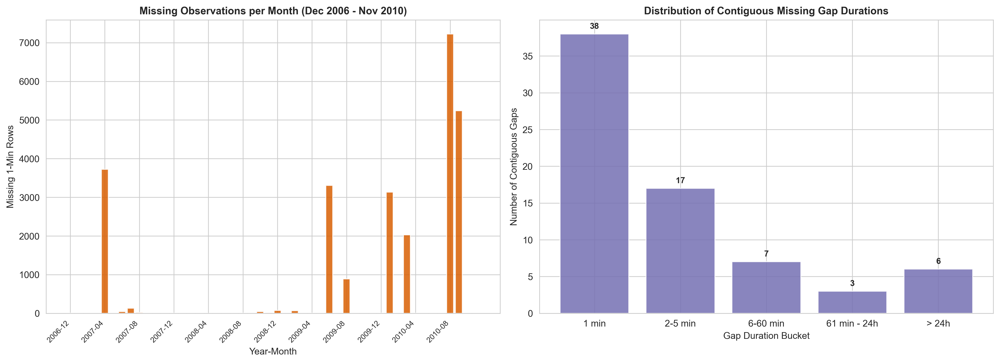

*Gambar 1. Ringkasan Distribusi Missing Values per Bulan dan Sebaran Panjang Gap Kontigu.*
Memperlihatkan konsentrasi lonjakan kekosongan data terutama pada April 2007, Juni 2009, Agustus 2010 (gap terpanjang 5.02 hari), dan September 2010 (3.64 hari) sehingga menuntut segmentasi pemutus gap.

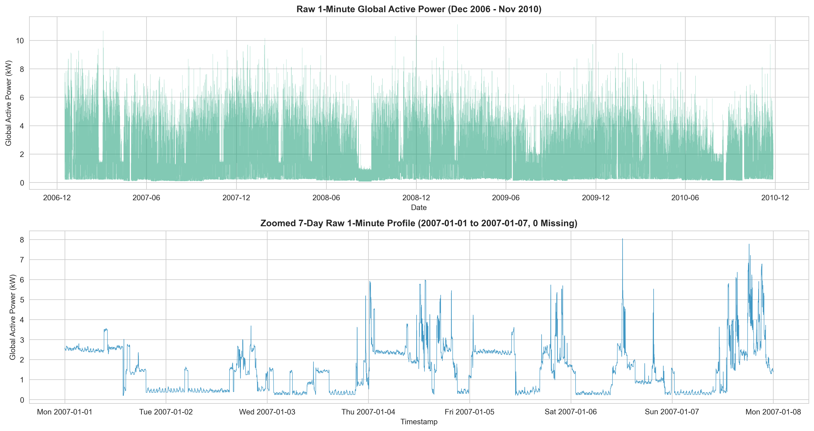

*Gambar 2. Tren Harian dan Rata-Rata Bergerak 30-Hari Global Active Power (2006–2010).*
Memperlihatkan siklus musiman tahunan yang konsisten: konsumsi daya meningkat tajam pada musim dingin (Desember–Februari) dan menurun hingga titik terendah pada musim panas (Juli–Agustus).

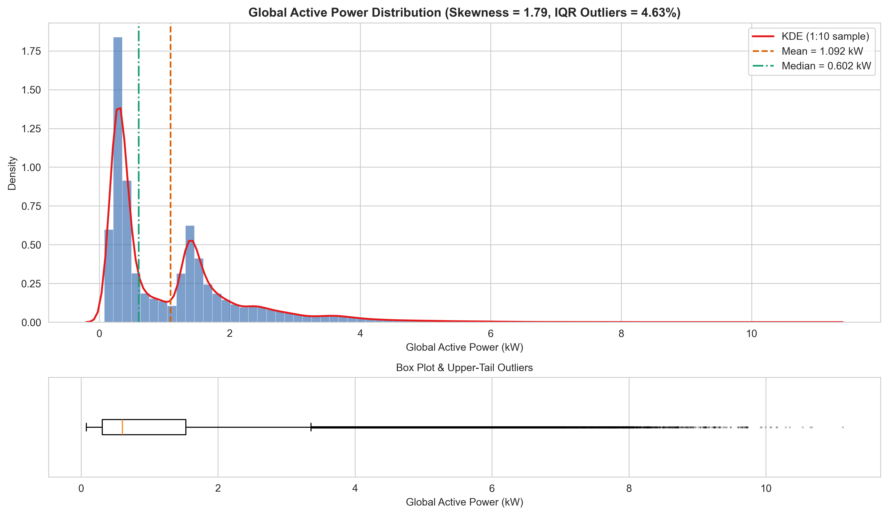

*Gambar 3. Distribusi Empiris, Transformasi Log, dan Analisis Outlier Global Active Power (1-Menit).*
Mengonfirmasi sifat distribusi bimodal miring ke kanan dengan mayoritas beban dasar di bawah 0.6 kW dan ekor panjang beban puncak hingga 11.122 kW.

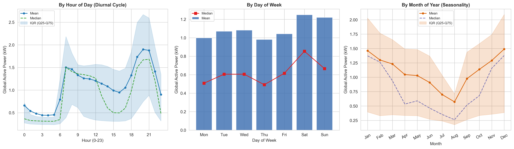

*Gambar 4. Profil Rata-Rata dan Median Konsumsi Daya Menurut Jam, Hari dalam Minggu, dan Bulan.*
Menjustifikasi inklusi fitur siklik jam, hari, dan bulan serta indikator akhir pekan (is_weekend) guna menangkap transisi diurnal pagi/malam dan kenaikan beban Sabtu–Minggu.

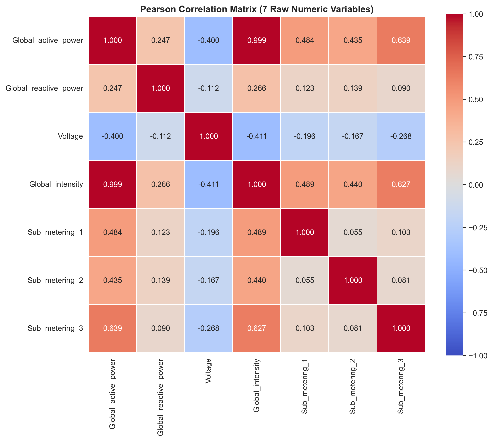

*Gambar 5. Matriks Korelasi Pearson dan Spearman Antarvariabel Pengukuran Listrik Mentah.*
Membuktikan kolinearitas nyaris sempurna antara Global_active_power dan Global_intensity (r = 0.9989) sekaligus hubungan moderat-kuat dengan Sub_metering_3 (r = 0.6386).

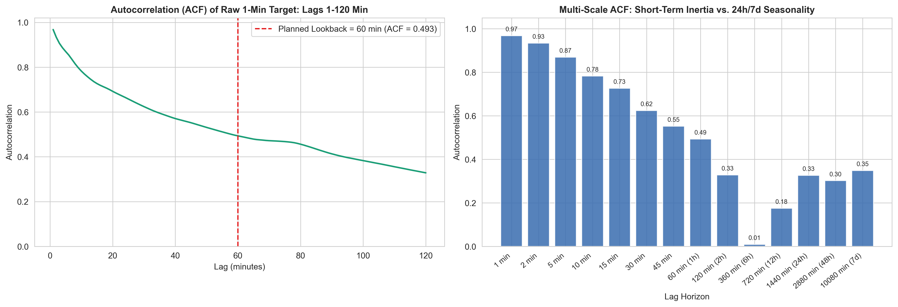

*Gambar 6. Fungsi Autokorelasi (ACF) Global Active Power pada Berbagai Skala Lag Waktu.*
Memperlihatkan kebangkitan autokorelasi pada lag 24 jam (0.3262) dan 7 hari (0.3481) yang mendukung kecukupan jendela lookback 60 jam (2.5 hari siklus diurnal).

## 4.2 Hasil Preprocessing, Normalisasi, dan Pembentukan Sequence

Dari 34,589 bin 1-jam sebelum pemangkasan ujung, penghapusan dua jam parsial batas awal dan akhir menghasilkan 34,587 interval jam utuh. Setelah penyaringan minimal 45 menit valid per jam dan interpolasi linear berbatas ≤ 60 menit sebanyak 5 jam khusus di split Train, tersedia 34,156 jam valid dan 431 jam tidak valid yang berfungsi sebagai batas pemisah dari 12 segmen kontigu. Tidak ada segmen yang terbuang karena durasinya kurang dari 61 jam (panjang minimum segmen ≥ 61 jam), menghasilkan total **33,436 *sequence* berbentuk `(N, 60, 13)`**.

**Tabel 4. Rekapitulasi Pembagian Kronologis, Interpolasi, dan Sequence per Split**

| Metrik / Tahap | Train (70%) | Validation (15%) | Test (15%) | Total / Catatan |
| :--- | ---: | ---: | ---: | :--- |
| Total slot waktu (jam) | 24,210 | 5,188 | 5,189 | 34,587 |
| Jam diinterpolasi (≤ 60 menit) | 5 | 0 | 0 | Hanya 5 jam di Train (2 arah) |
| Jam valid akhir | 24,073 | 5,102 | 4,981 | 34,156 |
| Jam gap dibiarkan NaN | 137 | 86 | 208 | 431 |
| Jumlah segmen kontigu | 6 | 3 | 3 | 12 |
| Jumlah sequence (window 60h) | 23,713 | 4,922 | 4,801 | 33,436 |
| Rentang fitur kontinu terskala | [0.0000 ; 1.0000] | [-0.0108 ; 0.9951] | [-0.0027 ; 1.0538] | Scaler fit khusus Train (24,073) |

*Catatan:* Enam pemeriksaan validasi otomatis pada metadata preprocessing menghasilkan status all_passed = True (kesalahan maksimum inverse_transform = 4.77 × 10<sup>-7</sup> kW).

Pada Tabel 4 terlihat dua bukti empiris penting ketiadaan kebocoran data: (1) fitur kontinu terskala pada split Validation sedikit di bawah 0 (`-0.010753`) dan pada split Test sedikit melampaui 1 (`1.05379`), yang membuktikan `MinMaxScaler` untuk target (min `0.124 kW`, max `6.5605 kW`) maupun fitur kontinu tidak pernah mengintip distribusi Validation/Test; serta (2) seluruh enam pemeriksaan otomatis (*no gap crossing*, urutan kronologis, anti-leakage, konsistensi dimensi `(N, 60, 13)` tipe *float32*, akurasi *inverse transform*, dan integritas SHA-256 berkas mentah) berstatus lolos (`passed: True`).

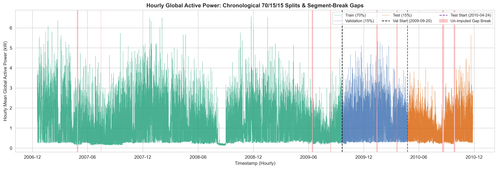

*Gambar 7. Pembagian Kronologis Train, Validation, Test dan Lokasi Blok Gap Data Hourly.*
Menunjukkan batas kronologis murni antar-split serta blok kekosongan berkepanjangan yang diperlakukan sebagai pemutus segmen.

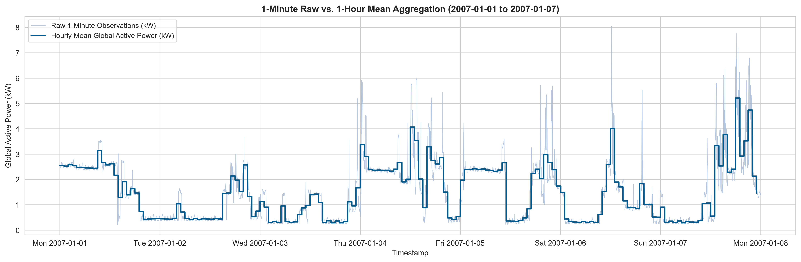

*Gambar 8. Perbandingan Seri Waktu 1-Menit Mentah vs Konsumsi Daya Rata-Rata 1-Jam.*
Memperlihatkan bagaimana agregasi per jam meredam noise lonjakan 1-menit tanpa menghilangkan siklus puncak pagi dan malam.

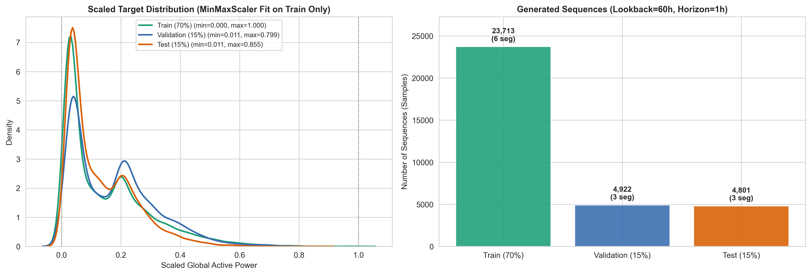

*Gambar 9. Distribusi Fitur Kontinu Terskala MinMaxScaler dan Panjang Segmen Sequence.*
Menggambarkan distribusi fitur hasil normalisasi train-only serta 12 segmen kontigu pada Train (6 segmen), Validation (3 segmen), dan Test (3 segmen).

## 4.3 Arsitektur Model Aktual dan Jumlah Parameter

Sesuai artefak `models/model_summary.txt`, model Stacked LSTM memiliki **32,929 parameter** (seluruhnya *trainable*, 0 *non-trainable*, ukuran bobot memori 128.63 KB). Rincian bentuk tensor keluaran dan jumlah parameter tiap lapisan disajikan pada Tabel 5.

**Tabel 5. Rincian Lapisan Arsitektur Stacked LSTM dan Jumlah Parameter**

| Nama Lapisan (Tipe) | Output Shape | Jumlah Parameter | Fungsi dalam Arsitektur |
| :--- | :---: | ---: | :--- |
| lstm_1 (LSTM, return_sequences=True) | (None, 60, 64) | 19,968 | Ekstraksi pola sekuensial tingkat rendah (64 unit) |
| dropout_1 (Dropout, p = 0.2) | (None, 60, 64) | 0 | Regularisasi aktivasi antar-lapisan LSTM |
| lstm_2 (LSTM, return_sequences=False) | (None, 32) | 12,416 | Kompresi representasi temporal bertingkat menjadi vektor konteks |
| dropout_2 (Dropout, p = 0.2) | (None, 32) | 0 | Regularisasi representasi sebelum kepala regresi |
| dense_hidden (Dense, activation='relu') | (None, 16) | 528 | Pemetaan non-linear fitur konteks berdimensi 16 |
| output_scaled (Dense, activation='linear') | (None, 1) | 17 | Proyeksi linear ke nilai prediksi terskala 1 jam ke depan |
| Total Parameter (Trainable) | — | 32,929 | Kapasitas ringkas (128.63 KB); Non-trainable = 0 |

*Catatan:* Sumber: models/model_summary.txt dan reports/evaluation_metrics.json.

**Kutipan Output Aktual models/model_summary.txt:**

```text
Model: "stacked_lstm_power_forecaster"
┌─────────────────────────────────┬────────────────────────┬───────────────┐
│ Layer (type)                    │ Output Shape           │       Param # │
├─────────────────────────────────┼────────────────────────┼───────────────┤
│ input_sequence (InputLayer)     │ (None, 60, 13)         │             0 │
├─────────────────────────────────┼────────────────────────┼───────────────┤
│ lstm_1 (LSTM)                   │ (None, 60, 64)         │        19,968 │
├─────────────────────────────────┼────────────────────────┼───────────────┤
│ dropout_1 (Dropout)             │ (None, 60, 64)         │             0 │
├─────────────────────────────────┼────────────────────────┼───────────────┤
│ lstm_2 (LSTM)                   │ (None, 32)             │        12,416 │
├─────────────────────────────────┼────────────────────────┼───────────────┤
│ dropout_2 (Dropout)             │ (None, 32)             │             0 │
├─────────────────────────────────┼────────────────────────┼───────────────┤
│ dense_hidden (Dense)            │ (None, 16)             │           528 │
├─────────────────────────────────┼────────────────────────┼───────────────┤
│ output_scaled (Dense)           │ (None, 1)              │            17 │
└─────────────────────────────────┴────────────────────────┴───────────────┘
 Total params: 32,929 (128.63 KB)
 Trainable params: 32,929 (128.63 KB)
 Non-trainable params: 0 (0.00 B)
```

## 4.4 Dinamika Pelatihan Model (Training History dan Grafik Loss)

Pelatihan pada CPU berjalan selama **33 epoch** dengan total waktu *682.73 detik* (11.38 menit, rata-rata 20.69 detik/epoch). Mekanisme *EarlyStopping* menghentikan pelatihan pada Epoch 33 dan memulihkan bobot terbaik dari **Epoch 25**, di mana *val_loss* (MSE terskala) mencapai titik terendah sebesar **0.006625** (*train_loss* saat pelatihan = 0.006871, *val_mae* terskala = 0.056211). Selama proses ini, `ReduceLROnPlateau` menurunkan *learning rate* sebanyak 4 kali dari `0.001` hingga `0.000063` (6.25 × 10<sup>-5</sup>).

**Tabel 6. Ringkasan Dinamika Training History pada Epoch Kunci (Skala Terskala [0, 1])**

| Epoch | Train Loss | Val Loss | Train MAE | Val MAE | LR Awal | Durasi (s) |
| :---: | ---: | ---: | ---: | ---: | ---: | ---: |
| 1 | 0.015210 | 0.010375 | 0.091667 | 0.076559 | 0.001 | 29.60 |
| 5 | 0.009320 | 0.008059 | 0.069192 | 0.066585 | 0.001 | 22.76 |
| 10 | 0.007970 | 0.007022 | 0.061997 | 0.060183 | 0.001 | 19.06 |
| 15 | 0.007454 | 0.006707 | 0.059075 | 0.057973 | 0.001 | 23.67 |
| 20 | 0.007091 | 0.006763 | 0.057098 | 0.056373 | 0.0005 | 17.99 |
| 25 (Best) | 0.006871 | 0.006625 | 0.056050 | 0.056211 | 0.00025 | 18.20 |
| 30 | 0.006767 | 0.006697 | 0.055627 | 0.056611 | 0.000125 | 18.78 |
| 33 | 0.006703 | 0.006668 | 0.055235 | 0.056637 | 6.25e-05 | 17.73 |

*Catatan:* Sumber: reports/training_history.csv. Train loss tercatat saat Dropout aktif (Dropout ON), sedangkan Val loss tanpa Dropout (Dropout OFF).

Sebagaimana tampak pada Tabel 6 dan Gambar 10, kurva *validation loss* menurun cepat pada 10 epoch pertama dan melandai secara stabil hingga Epoch 25 tanpa menunjukkan kenaikan tajam yang menjadi ciri *overfitting* berat. Meskipun nilai *train_loss* pada Epoch 25 (`0.006871`) sedikit lebih tinggi daripada *val_loss* (`0.006625`), perbandingan langsung keduanya harus dibaca secara hati-hati karena *train_loss* dihitung selama *forward pass* pelatihan dengan lapisan **Dropout(0.2) aktif**. Karena evaluasi terpisah pada split Train menggunakan mode inferensi (**Dropout OFF**) belum tersedia pada artefak eksperimen ini, **kemungkinan adanya *mild overfitting* belum dapat dikesampingkan secara mutlak**.

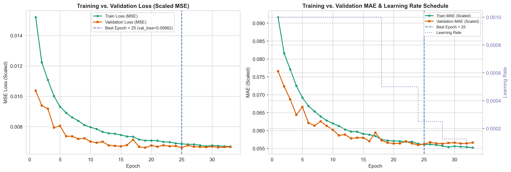

*Gambar 10. Kurva Training Loss vs Validation Loss (MSE), MAE Terskala, dan Jadwal Penurunan Learning Rate.*
Menunjukkan konvergensi halus hingga Epoch 25 (garis putus-putus) dengan 4 kali reduksi learning rate dan tidak adanya divergensi tajam pada kurva validasi.

## 4.5 Hasil Evaluasi Validation & Test serta Perbandingan Baseline

Model terbaik (`models/stacked_lstm_best.keras`) dimuat ulang untuk inferensi Validation (4,922 *window*) dan Test (4,801 *window*) dengan total waktu prediksi gabungan 2.411 detik, lalu dikembalikan ke satuan fisik kW asli sebelum dihitung metriknya. Hasil lengkap evaluasi pada kedua split disajikan pada Tabel 7.

**Tabel 7. Perbandingan Performa Stacked LSTM vs Baseline pada Validation dan Test (Satuan Asli kW)**

| Split | Model | MAE (kW) | MSE (kW²) | RMSE (kW) | R² |
| :--- | :--- | ---: | ---: | ---: | ---: |
| Validation (n=4,922) | Persistence Baseline | 0.4630 | 0.4761 | 0.6900 | 0.3953 |
| Validation (n=4,922) | Seasonal Naive 24-hour | 0.6644 | 0.9138 | 0.9560 | -0.1605 |
| Validation (n=4,922) | Stacked LSTM (Model Utama) | 0.3618 | 0.2745 | 0.5239 | 0.6514 |
| Test (n=4,801) | Persistence Baseline | 0.3908 | 0.3484 | 0.5903 | 0.3177 |
| Test (n=4,801) | Seasonal Naive 24-hour | 0.5089 | 0.5738 | 0.7575 | -0.1238 |
| Test (n=4,801) | Stacked LSTM (Model Utama) | 0.3159 | 0.2149 | 0.4635 | 0.5792 |

*Catatan:* Sumber: reports/evaluation_metrics.json dan reports/evaluation_metrics.csv.

Pada split **Test**, model **Stacked LSTM** mencatat **MAE = 0.3159 kW**, **MSE = 0.2149 kW²**, **RMSE = 0.4635 kW**, dan **R² = 0.5792**. Dibandingkan *baseline* **Persistence**, Stacked LSTM menurunkan MAE sebesar **19.18%** (dari 0.3908 kW menjadi 0.3159 kW), menurunkan MSE sebesar **38.33%**, menurunkan RMSE sebesar **21.47%** (dari 0.5903 kW menjadi 0.4635 kW), dan menaikkan koefisien determinasi R² sebesar **+0.2615** (dari 0.3177 ke 0.5792). Keunggulan konsisten juga terlihat pada split **Validation**, dengan reduksi MAE sebesar 21.86% dan reduksi RMSE sebesar 24.08% terhadap Persistence.

Sebaliknya, *baseline* **Seasonal Naive 24-hour** memperoleh nilai R² negatif pada kedua split (`-0.1605` pada Validation dan `-0.1238` pada Test). Hal tersebut terjadi karena menyalin mentah-mentah beban 24 jam sebelumnya sering memproyeksikan lonjakan aktivitas peralatan rumah tangga yang tidak berulang pada jam sama keesokan harinya (serta pergeseran akhir pekan vs hari kerja), sehingga galat kuadratiknya melebihi prediktor rata-rata sampel. Stacked LSTM melampaui Seasonal Naive 24-hour pada Test dengan reduksi MAE **37.93%**, reduksi MSE **62.55%**, dan reduksi RMSE **38.81%**.

Keunggulan Stacked LSTM terutama muncul pada jam-jam transisi beban terprediksi: pada pukul **07:00** saat penghuni rumah mulai beraktivitas, MAE Test turun dari 0.7615 kW (Persistence) menjadi **0.3905 kW** (reduksi ~48.7%); demikian pula saat penurunan beban larut malam pukul 22:00 (0.5782 → 0.3798 kW) dan 23:00 (0.5217 → 0.3044 kW). Pola keselarasan antara seri aktual dan hasil prediksi pada data Test ditampilkan pada Gambar 11.

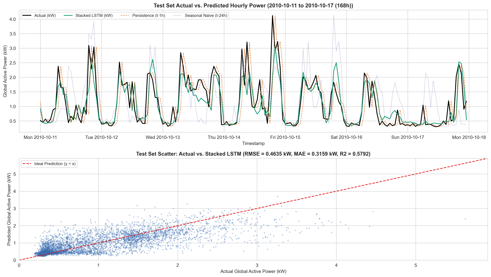

*Gambar 11. Perbandingan Nilai Aktual vs Prediksi Stacked LSTM pada Data Test dan Sampel 14 Hari.*
Prediksi Stacked LSTM mengikuti irama naik-turun harian dengan presisi baik pada beban rendah dan menengah, namun cenderung melandaikan lonjakan ekstrem sesaat (> 3.0 kW).

## 4.6 Analisis Residual dan Performa Berdasarkan Regimen Beban

Residual didefinisikan sebagai `e = y_true − y_pred` dalam kW, sehingga nilai positif berarti model memprediksi lebih rendah (*underprediction*) dan nilai negatif berarti model memprediksi terlalu tinggi (*overprediction*). Secara agregat, bias rata-rata pada Test hanya `+0.0290 kW` (median `-0.0262 kW`, standar deviasi `0.4627 kW`), namun sebaran ekor kesalahan memanjang hingga `+3.2351 kW` (*persentil ke-99 |error|* = 1.6060 kW). Pembagian performa Test ke dalam tiga regimen tingkat konsumsi mengungkap asimetri kesalahan yang sangat jelas (Tabel 8).

**Tabel 8. Ringkasan Statistik Residual dan Analisis Kesalahan per Regimen Beban pada Split Test**

| Segmen Evaluasi | Jumlah Sampel (%) | MAE (kW) | RMSE (kW) | Mean Bias (kW) [y_true − y_pred] |
| :--- | ---: | ---: | ---: | :--- |
| Validation Total (Ringkasan) | 4,922 (100.00%) | 0.3618 | 0.5239 | +0.0239 (std 0.5234) |
| Test Total (Ringkasan) | 4,801 (100.00%) | 0.3159 | 0.4635 | +0.0290 (std 0.4627) |
| Test — Beban Rendah (< 0.5 kW) | 1,916 (39.91%) | 0.1657 | 0.2730 | -0.1499 (overprediction ringan) |
| Test — Beban Menengah (0.5–2.0 kW) | 2,453 (51.09%) | 0.3507 | 0.4452 | +0.0460 (hampir tak berbias) |
| Test — Beban Puncak (> 2.0 kW) | 432 (9.00%) | 0.7841 | 0.9654 | +0.7253 (underprediction signifikan) |

*Catatan:* Sumber: reports/evaluation_metrics.json (bagian residual_analysis).

**Analisis Kecenderungan Underprediction pada Konsumsi Puncak:** Meskipun kelompok beban menengah (`0.5–2.0 kW`, 51.09% data Test) terprediksi akurat dengan bias mendekati nol (`+0.0460 kW`), pada rezim **beban puncak di atas 2.0 kW** (432 sampel atau 9.00% data Test) kesalahan melonjak ke **MAE = 0.7841 kW** dan **RMSE = 0.9654 kW** dengan **bias positif besar `+0.7253 kW`**. Artinya, rata-rata prediksi model pada jam beban puncak tertinggal ~0.73 kW di bawah kenyataan. Fenomena ini disebabkan oleh tiga faktor: (1) pelatihan dengan fungsi loss MSE mendorong model menaksir ekspektasi bersyarat (*conditional mean*) yang aman sehingga meredam prediksi ekstrem; (2) proporsi jam beban tinggi relatif jarang (sekitar 9% pada Test); serta (3) penyalaan peralatan berdaya besar secara mendadak tidak dapat dijelaskan hanya dari riwayat listrik 60 jam tanpa sinyal eksternal seperti suhu lingkungan maupun jadwal aktivitas penghuni.

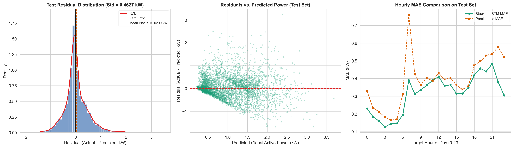

*Gambar 12. Histogram Distribusi Residual, Plot Residual vs Nilai Prediksi, serta Profil MAE/Bias per Jam (Test).*
Memperlihatkan residual terkonsentrasi simetris di sekitar nol pada prediksi rendah-menengah, serta ekor kanan positif yang tegas pada jam puncak pagi/malam.

## 4.7 Evaluasi Kelebihan, Kekurangan, dan Keterbatasan Eksperimen

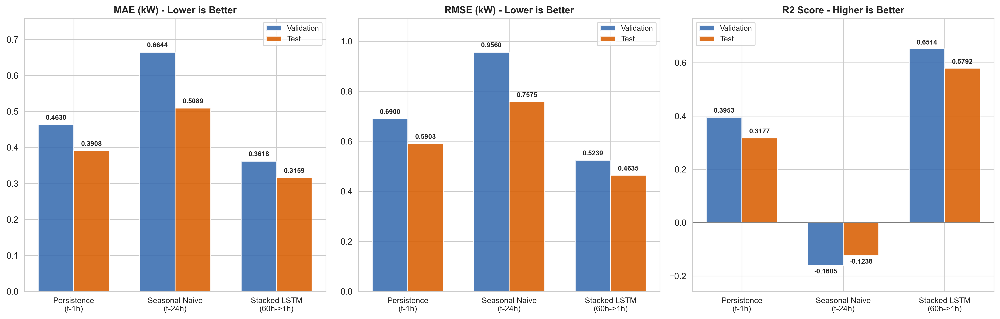

*Gambar 13. Perbandingan Komprehensif MAE, RMSE, dan R² Stacked LSTM vs Baseline pada Validation dan Test.*
Menegaskan dominasi konsisten Stacked LSTM atas Persistence dan Seasonal Naive 24-hour di seluruh metrik dan kedua split evaluasi.

Secara menyeluruh, sintesis atas kelebihan, kekurangan, serta keterbatasan eksperimen pertama berdasarkan bukti audit teknis adalah sebagai berikut:

### A. Kelebihan Model dan Metodologi

- **Akurasi Generalisasi Kuat terhadap Baseline:** Menurunkan MAE sebesar 19.18% pada Test (21.86% pada Validation) dan meningkatkan R² menjadi 0.5792 (0.6514 pada Validation) dibanding Persistence yang sudah cukup kompetitif pada lag 1 jam.
- **Integritas Anti-Leakage Terverifikasi:** Pemisahan kronologis murni, *fitting* `MinMaxScaler` eksklusif pada 24,073 baris valid Train, eksklusi fitur kolinear `Global_intensity`, serta larangan *window* melintasi *gap* memastikan skor evaluasi mencerminkan kemampuan generalisasi kausal sesungguhnya.
- **Efisiensi Komputasi CPU-Only:** Kapasitas ringkas 32,929 parameter mencapai konvergensi dalam ~11.38 menit pelatihan dan ~2.41 detik inferensi gabungan Val+Test tanpa memerlukan GPU.

### B. Kekurangan Model

- **Bias Underprediction pada Beban Puncak:** Model secara sistematis meremehkan konsumsi di atas 2.0 kW (`mean bias = +0.7253 kW`), yang membatasi kelayakan pemakaiannya untuk sistem proteksi beban maksimum tanpa koreksi tambahan.
- **Ketiadaan Variabel Eksogen:** Dataset hanya berisi besaran kelistrikan dan kalender siklik, tanpa informasi cuaca, temperatur, jumlah penghuni, maupun hari libur nasional yang sangat memengaruhi pemanas air dan AC.
- **Keterbatasan Horizon Tunggal:** Model hanya dilatih memprediksi 1 jam ke depan sehingga belum mendukung peramalan *multi-step* langsung (misalnya 6–24 jam ke depan).

### C. Keterbatasan Eksperimen (Hasil Audit Teknis)

1. **Interpolasi Dua Arah Terbatas pada Lima Jam Train:** Terdapat 5 jam pada split Train yang diinterpolasi dengan `interpolate(method='time')` (memanfaatkan titik sebelum dan sesudah dalam batas *gap* ≤ 60 menit). Meskipun secara lokal mengurangi kausalitas ketat pada 5 titik tersebut, dampaknya terisolasi di Train dan **tidak ada satu pun jam pada split Validation maupun Test yang diinterpolasi (0 jam)**.
2. **Evaluasi Train Mode Dropout OFF Belum Tersedia:** Artefak eksperimen pertama mencatat `train_loss` ketika *Dropout(0.2)* aktif saat latihan, namun tidak menyimpan hasil evaluasi ulang split Train dalam mode inferensi (`Dropout OFF`). Walaupun kurva *validation loss* tidak menunjukkan tanda *overfitting* berat, **mild overfitting belum dapat dikesampingkan secara absolut**.
3. **Telemetri Memori Proses Historis Bernilai Null:** Pada berkas `evaluation_metrics.json`, kolom `rss_mb` dan `peak_rss_mb` bernilai `null` akibat ketidaksesuaian API pemantauan memori Windows saat pelatihan berlangsung (telah diperbaiki pada kode `src/train.py` untuk eksekusi di masa mendatang tanpa menjalankan ulang eksperimen pertama).


---

# BAB V – KESIMPULAN DAN SARAN

## 5.1 Kesimpulan

Berdasarkan seluruh tahapan *Exploratory Data Analysis*, *preprocessing* berbasis segmentasi, pelatihan pada CPU, evaluasi dalam satuan kW asli, serta audit teknis pasca-eksperimen, disimpulkan hal-hal berikut sesuai tujuan praktikum:

1. Audit terhadap 2,075,259 baris data mentah 1-menit berhasil memetakan 25,979 observasi hilang simultan dalam 71 *gap* kontigu, kolinearitas ekstrem `Global_intensity` (*r* = 0.9989), serta pola diurnal dan musiman yang jelas. Agregasi menjadi 34,587 slot 1-jam dengan ambang ≥ 45/60 menit valid, eksklusi `Global_intensity`, pengkodean 7 fitur temporal, *fitting* `MinMaxScaler` hanya pada 24,073 baris valid Train, serta pembentukan 33,436 *sliding window* `(60, 13)` tanpa melintasi *gap* terbukti lolos seluruh 6 uji validasi anti-*data leakage*.
2. Arsitektur **Stacked LSTM** berkapasitas 32,929 parameter berhasil dilatih pada lingkungan CPU-only selama 33 epoch (11.38 menit) dengan konvergensi optimal pada **Epoch 25** (`val_loss = 0.006625`). Pada evaluasi split **Test** (4,801 *sequence*), model mencapai **MAE = 0.3159 kW**, **MSE = 0.2149 kW²**, **RMSE = 0.4635 kW**, dan **R² = 0.5792** (serta pada Validation: MAE 0.3618 kW, RMSE 0.5239 kW, R² 0.6514). Hasil ini secara meyakinkan mengungguli *baseline* **Persistence** (reduksi MAE 19.18% dan RMSE 21.47% pada Test) serta **Seasonal Naive 24-hour** (reduksi MAE 37.93% pada Test).
3. Meskipun performa keseluruhan kompetitif pada rezim beban rendah hingga menengah, analisis residual mengidentifikasi kelemahan utama berupa **underprediction sistematis pada beban puncak > 2.0 kW** (bias `+0.7253 kW`, MAE `0.7841 kW`). Di samping itu, tercatat keterbatasan eksperimental berupa 5 jam interpolasi dua arah khusus di Train (0 di Validation/Test) serta belum tersedianya metrik evaluasi Train dalam mode *Dropout OFF*, sehingga kemungkinan *mild overfitting* tetap dicatat secara eksplisit.

## 5.2 Saran Pengembangan Berikutnya

Untuk penyempurnaan eksperimen pada siklus penelitian selanjutnya tanpa mengubah keutuhan hasil eksperimen pertama, disarankan empat langkah berikut:

1. **Penambahan Evaluasi Train Inference (Dropout OFF) & Telemetri Memori:** Menjalankan pencatatan `model.evaluate` pada split Train dalam mode inferensi guna mengukur selisih generalisasi (*generalization gap*) secara adil sekaligus mengaktifkan fungsi pemantauan RSS memori yang telah diperbaiki.
2. **Penanganan Khusus Beban Puncak (*Peak Load*):** Menguji fungsi loss berbobot (*weighted MSE*), *Huber loss*, atau *quantile regression*, serta menambahkan fitur statistik volatilitas lokal (seperti standar deviasi berjalan 6–24 jam terakhir) untuk menekan bias *underprediction* di atas 2.0 kW.
3. **Integrasi Fitur Eksogen dan Horizon Multi-Step:** Memperkaya fitur input dengan data suhu udara lokal dan kalender hari libur Prancis, serta membandingkan kinerja Stacked LSTM terhadap arsitektur sekuensial lain seperti GRU, 1D-CNN-LSTM, atau mekanisme Attention untuk peramalan multi-horizon (6–24 jam).
4. **Imputasi Kausal Murni (Forward-Only):** Apabila protokol menuntut kausalitas absolut hingga ke level interpolasi *gap* pendek pada data Train, interpolasi dua arah dapat diganti dengan imputasi satu arah (*forward-fill* terbatas atau *Kalman smoother* kausal).


---

# DAFTAR PUSTAKA

1. Abadi, M., Agarwal, A., Barham, P., Brevdo, E., Chen, Z., Citro, C., Corrado, G. S., Davis, A., Dean, J., Devin, M., Ghemawat, S., Goodfellow, I., Harp, A., Irving, G., Isard, M., Jia, Y., Jozefowicz, R., Kaiser, L., Kudlur, M., ... Zheng, X. (2016). TensorFlow: A system for large-scale machine learning. Dalam *Proceedings of the 12th USENIX Symposium on Operating Systems Design and Implementation (OSDI '16)* (hlm. 265–283). USENIX Association. https://www.usenix.org/conference/osdi16/technical-sessions/presentation/abadi
2. Chicco, D., Warrens, M. J., & Jurman, G. (2021). The coefficient of determination R-squared is more informative than SMAPE, MAE, MAPE, MSE and RMSE in regression analysis evaluation. *PeerJ Computer Science*, 7, e623. https://doi.org/10.7717/peerj-cs.623
3. Gers, F. A., Schmidhuber, J., & Cummins, F. (2000). Learning to forget: Continual prediction with LSTM. *Neural Computation*, 12(10), 2451–2471. https://doi.org/10.1162/089976600300015015
4. Goodfellow, I., Bengio, Y., & Courville, A. (2016). *Deep Learning*. MIT Press. ISBN: 978-0262035613. https://www.deeplearningbook.org/
5. Graves, A., Mohamed, A., & Hinton, G. (2013). Speech recognition with deep recurrent neural networks. Dalam *2013 IEEE International Conference on Acoustics, Speech and Signal Processing (ICASSP)* (hlm. 6645–6649). IEEE. https://doi.org/10.1109/ICASSP.2013.6638947
6. Hébrail, G., & Bérard, A. (2012). *Individual Household Electric Power Consumption* [Dataset]. UCI Machine Learning Repository. https://doi.org/10.24432/C58K54
7. Hochreiter, S., & Schmidhuber, J. (1997). Long short-term memory. *Neural Computation*, 9(8), 1735–1780. https://doi.org/10.1162/neco.1997.9.8.1735
8. Hyndman, R. J., & Athanasopoulos, G. (2021). *Forecasting: Principles and Practice* (Edisi ke-3). OTexts. https://otexts.com/fpp3/
9. Kingma, D. P., & Ba, J. (2015). Adam: A method for stochastic optimization. Dalam *3rd International Conference on Learning Representations (ICLR 2015)*. https://doi.org/10.48550/arXiv.1412.6980
10. Kong, W., Dong, Z. Y., Jia, Y., Hill, D. J., Xu, Y., & Zhang, Y. (2019). Short-term residential load forecasting based on LSTM recurrent neural network. *IEEE Transactions on Smart Grid*, 10(1), 841–851. https://doi.org/10.1109/TSG.2017.2753802
11. Pascanu, R., Mikolov, T., & Bengio, Y. (2013). On the difficulty of training recurrent neural networks. Dalam *Proceedings of the 30th International Conference on Machine Learning (ICML)*, *PMLR*, 28(3), 1310–1318. https://proceedings.mlr.press/v28/pascanu13.html
12. Pedregosa, F., Varoquaux, G., Gramfort, A., Michel, V., Thirion, B., Grisel, O., Blondel, M., Prettenhofer, P., Weiss, R., Dubourg, V., Vanderplas, J., Passos, A., Cournapeau, D., Brucher, M., Perrot, M., & Duchesnay, É. (2011). Scikit-learn: Machine learning in Python. *Journal of Machine Learning Research*, 12(85), 2825–2830. https://jmlr.org/papers/v12/pedregosa11a.html
13. Srivastava, N., Hinton, G., Krizhevsky, A., Sutskever, I., & Salakhutdinov, R. (2014). Dropout: A simple way to prevent neural networks from overfitting. *Journal of Machine Learning Research*, 15(56), 1929–1958. https://jmlr.org/papers/v15/srivastava14a.html
