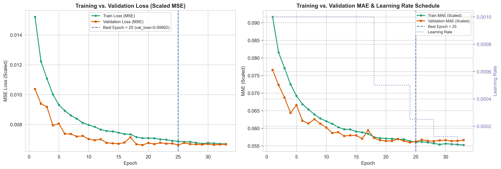
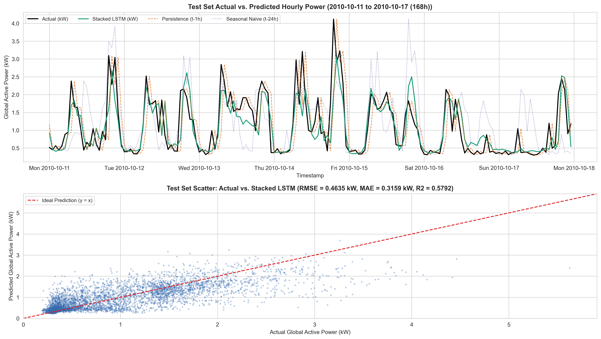
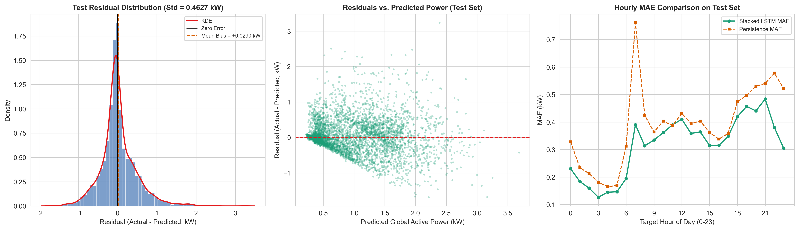
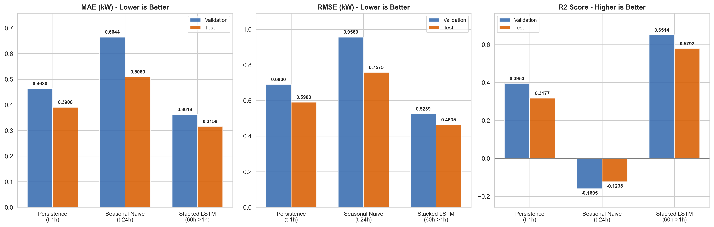

# Laporan Eksperimen Baseline & Stacked LSTM — Household Electric Power Consumption

**Tanggal Eksperimen:** 2026-11-25  
**Skrip:** `src/train.py` | **Model Terbaik:** `models/stacked_lstm_best.keras` | **Metrik Terukur:** `reports/evaluation_metrics.json`  
**Target Forecasting:** Konsumsi daya aktif rata-rata (`Global_active_power`, satuan kW) pada **1 jam berikutnya** dari lookback **60 jam** (`13` fitur input).

---

## 1. Konfigurasi Eksperimen, Arsitektur, & Lingkungan CPU

- **Perangkat Keras & Software:** CPU-only (`CUDA_VISIBLE_DEVICES = "-1"`, `logical_gpus = []`), prosesor `Intel64 Family 6 Model 154 Stepping 4` (`12` logical CPU cores), Python `3.10.6`, TensorFlow `2.21.0`, Keras `3.12.4`, seed `42`.
- **Dataset Sequence & Kebijakan Shuffle (Read-Only dari `data/processed/`):**
  - **Train:** `23.713` sequence `(23713, 60, 13)`. Urutan `60` timestep di dalam setiap window tetap **kronologis penuh** (`t_0 .. t_59 -> t_60`); pengacakan pada `train_ds` (`.shuffle(buffer_size=4096, seed=42, reshuffle_each_iteration=True)`) **hanya terjadi antar-window independen di dalam Train** (bersifat *partial shuffle* karena `buffer_size = 4096 < 23.713`) untuk menstabilkan gradien Adam pada model stateless LSTM.
  - **Validation:** `4.922` sequence `(4922, 60, 13)` (**tidak diacak**, urutan kronologis penuh).
  - **Test:** `4.801` sequence `(4801, 60, 13)` (**tidak diacak**, urutan kronologis penuh; **tidak digunakan untuk tuning**).
- **Kebijakan Interpolasi Data Input:**
  - Terdapat **`5` jam** data di dalam **Train** (`2007-06-09 18:00:00`, `2007-08-01 08:00:00`, `2008-10-25 10:00:00`, `2009-02-01 16:00:00`, `2009-02-17 10:00:00` — `0,021%` dari `24.073` jam valid Train) yang diinterpolasi menggunakan metode *time-based linear interpolation* dua arah (`t-1h` dan `t+1h`). Secara kausal murni, kelima titik latih tersebut memakai informasi 1 jam ke depan di dalam batas split Train.
  - **Tidak ada satu pun jam pada Validation (`0`) maupun Test (`0`) yang diinterpolasi.** Seluruh gap yang tersisa (`137` jam di Train, `86` jam di Val, `208` jam di Test) dibiarkan sebagai pemutus segmen (*segment break*) sehingga tidak ada sequence yang melintasi gap.
- **Arsitektur Stacked LSTM (`32.929` parameter, `128,63 KB`, 100% trainable):**
  1. `Input(shape=(60, 13))`
  2. `LSTM(64, return_sequences=True)` — `19.968` params
  3. `Dropout(0.2)`
  4. `LSTM(32)` — `12.416` params
  5. `Dropout(0.2)`
  6. `Dense(16, activation='relu')` — `528` params
  7. `Dense(1, activation='linear')` — `17` params
- **Hyperparameter Training:** `Adam(lr=0.001, clipnorm=1.0)`, `loss='mse'`, `batch_size=64`, `max_epochs=50`, `EarlyStopping(monitor='val_loss', patience=8, restore_best_weights=True)`, `ModelCheckpoint(save_best_only=True)`, `ReduceLROnPlateau(monitor='val_loss', factor=0.5, patience=4, min_lr=1e-6)`.
- **Waktu & Resource:**
  - Total waktu training (`33` epoch): **`682,73 detik` (`11,38 menit`)**, rata-rata **`20,69 detik/epoch`**.
  - Waktu inferensi evaluasi (Validation + Test): **`2,411 detik`**.
  - *Catatan Audit Memori:* Pada artefak eksperimen pertama ([evaluation_metrics.json](evaluation_metrics.json)), field memori proses tercatat `null` akibat bug deklarasi tipe handle 64-bit pada `ctypes`/`psapi` saat training berjalan; nilai historis `null` tersebut dipertahankan apa adanya tanpa estimasi. Implementasi `get_process_memory_mb()` di `src/train.py` telah diperbaiki untuk eksperimen berikutnya.

---

## 2. Perbandingan Baseline vs. Stacked LSTM (Satuan Asli kW)

Seluruh prediksi dikembalikan ke satuan asli **kW** via `target_scaler.inverse_transform()` sebelum menghitung metrik. Indeks lag baseline (`X[:, -1, 0]` untuk $t-1\text{h}$ dan `X[:, -24, 0]` untuk $t-24\text{h}$) telah diverifikasi silang terhadap `data/processed/hourly_dataset.csv` dengan galat $< 10^{-4}\text{ kW}$.

### 2.1 Validation Set (`4.922` sequence | Sep 2009 – Apr 2010)

| Model | MAE (kW) | MSE ($\text{kW}^2$) | RMSE (kW) | $R^2$ |
| :--- | ---: | ---: | ---: | ---: |
| **Persistence (`t - 1h`)** | 0,4630 | 0,4761 | 0,6900 | 0,3953 |
| **Seasonal Naive (`t - 24h`)** | 0,6644 | 0,9138 | 0,9560 | -0,1605 |
| **Stacked LSTM (60h $\to$ 1h)** | **0,3618** | **0,2745** | **0,5239** | **0,6514** |

- **Perbaikan Stacked LSTM vs. Persistence (Validation):** MAE turun **`21,86%`**, MSE turun **`42,35%`**, RMSE turun **`24,08%`**, $R^2$ naik **`+0,2561`**.
- **Perbaikan Stacked LSTM vs. Seasonal Naive 24h (Validation):** MAE turun **`45,55%`**, MSE turun **`69,97%`**, RMSE turun **`45,20%`**, $R^2$ naik **`+0,8120`**.

### 2.2 Test Set (`4.801` sequence | Apr 2010 – Nov 2010)

| Model | MAE (kW) | MSE ($\text{kW}^2$) | RMSE (kW) | $R^2$ |
| :--- | ---: | ---: | ---: | ---: |
| **Persistence (`t - 1h`)** | 0,3908 | 0,3484 | 0,5903 | 0,3177 |
| **Seasonal Naive (`t - 24h`)** | 0,5089 | 0,5738 | 0,7575 | -0,1238 |
| **Stacked LSTM (60h $\to$ 1h)** | **0,3159** | **0,2149** | **0,4635** | **0,5792** |

- **Perbaikan Stacked LSTM vs. Persistence (Test):** MAE turun **`19,18%`**, MSE turun **`38,33%`**, RMSE turun **`21,47%`**, $R^2$ naik **`+0,2615`**.
- **Perbaikan Stacked LSTM vs. Seasonal Naive 24h (Test):** MAE turun **`37,93%`**, MSE turun **`62,55%`**, RMSE turun **`38,81%`**, $R^2$ naik **`+0,7030`**.

> **Catatan Mengapa Seasonal Naive 24h Bernilai $R^2 < 0$:** Pada skala jam tunggal di tingkat satu rumah tangga, jam nyala peralatan (memasak, laundry, water heater) bergeser $\pm 1\text{--}3$ jam dari hari ke hari sehingga menyalin nilai tepat 24 jam lalu sering menghasilkan error ganda (*double penalty*), jauh kalah dari rata-rata konstan maupun Persistence.

---

## 3. Audit Proses Training & Konvergensi

- **Penghentian & Epoch Terbaik:** `EarlyStopping` menghentikan training pada **Epoch 33** dan memulihkan bobot terbaik dari **Epoch 25**.
- **Kurva Loss (`train_loss` vs `val_loss`) & Indikasi Overfitting:**
  - Pada Epoch 25, `val_loss` (MSE terskala) mencapai **`0,006625`** (`val_mae = 0,056211`), sementara `train_loss` bernilai **`0,006871`** (`train_mae = 0,056050`).
  - Kurva `val_loss` menurun stabil hingga Epoch 25 lalu mendatar di kisaran `0,00663–0,00677` hingga Epoch 33 tanpa lonjakan divergensi, serta metrik Test konsisten baik. Dengan demikian, **kurva validation loss tidak menunjukkan indikasi overfitting berat** selama 33 epoch di bawah penjadwalan `ReduceLROnPlateau` (4 kali penurunan LR: `0,001 → 0,0005 → 0,00025 → 0,000125 → 6,25e-5`).
  - **Catatan Keterbatasan Audit:** Evaluasi `best_model` pada dataset Train dalam mode inferensi (`training=False`, yaitu dengan `Dropout(0.2)` dinonaktifkan) **belum tersedia** pada artefak eksperimen pertama. Karena `train_loss` dalam riwayat `model.fit()` diukur dengan Dropout aktif dan dirata-ratakan sepanjang batch dalam epoch, kemungkinan adanya **mild overfitting** belum dapat dikesampingkan sepenuhnya secara kuantitatif.
- **Konsistensi Validation vs. Test:** Nilai MAE & RMSE pada Test (`0,3159` & `0,4635 kW`) lebih rendah daripada Validation (`0,3618` & `0,5239 kW`). Penurunan $R^2$ dari `0,6514` (Val) menjadi `0,5792` (Test) disebabkan oleh varians alami beban musim semi–panas–gugur (Test) yang lebih rendah dibanding musim gugur–dingin (Val) — pola yang konsisten juga terjadi pada Persistence (`0,3953 → 0,3177`).

---

## 4. Analisis Residual & Pola Error

### 4.1 Ringkasan Residual (`Actual - Predicted`, satuan kW)

| Metrik Residual | Validation | Test |
| :--- | ---: | ---: |
| **Mean Bias** | `+0,0239 kW` | `+0,0290 kW` |
| **Std Deviasi** | `0,5234 kW` | `0,4627 kW` |
| **Median** | `-0,0439 kW` | `-0,0262 kW` |
| **Q25 / Q75** | `-0,2159 / +0,2603 kW` | `-0,1864 / +0,2235 kW` |
| **Min / Max** | `-1,8993 / +3,4386 kW` | `-1,6841 / +3,2351 kW` |
| **95th / 99th Percentile Abs Error** | `1,1100 / 1,7457 kW` | `0,9611 / 1,6060 kW` |

### 4.2 Error per Rezim Beban (Test Set)

| Rezim Beban Aktual | Jumlah Sampel | Proporsi | MAE (kW) | RMSE (kW) | Mean Bias (`Actual - Pred`, kW) |
| :--- | ---: | ---: | ---: | ---: | ---: |
| **Low (`< 0,5 kW`)** | 1.916 | 39,91% | 0,1657 | 0,2730 | `-0,1499` *(sedikit overpredict)* |
| **Medium (`0,5 – 2,0 kW`)** | 2.453 | 51,09% | 0,3507 | 0,4452 | `+0,0460` *(hampir tak bias)* |
| **High (`> 2,0 kW`)** | 432 | 9,00% | 0,7841 | 0,9654 | **`+0,7253` *(cenderung underpredict puncak)*** |

### 4.3 Error per Jam (Test Set)
- **Keunggulan Puncak pada Jam Transisi:** Stacked LSTM mengungguli Persistence hampir di seluruh 24 jam, paling menonjol pada pukul **`07:00`** (MAE Persistence `0,7615 kW` $\to$ LSTM **`0,3905 kW`**, turun ~48,7%), **`22:00`** (`0,5782` $\to$ **`0,3798 kW`**), dan **`23:00`** (`0,5217` $\to$ **`0,3044 kW`**). Fitur siklikal waktu + lookback 60 jam berhasil mengantisipasi pola bangun pagi dan penurunan malam hari tanpa jeda keterlambatan 1 jam.
- **Jam dengan Error Tertinggi:** Pukul `19:00–21:00` (`MAE 0,4406–0,4838 kW`) karena beban puncak memasak/peralatan malam memiliki variabilitas acak tertinggi.

---

## 5. Visualisasi Evaluasi

1. **Kurva Training & Validation Loss/MAE + Learning Rate** — `reports/figures/10_training_validation_loss.png`  
   

2. **Nilai Aktual vs. Prediksi (Test 7 Hari & Scatter Plot)** — `reports/figures/11_actual_vs_predicted_test.png`  
   

3. **Distribusi Residual, Residual vs. Predicted, & Error per Jam** — `reports/figures/12_residual_and_error_analysis.png`  
   

4. **Perbandingan Metrik Baseline vs. Stacked LSTM** — `reports/figures/13_model_comparison_metrics.png`  
   

---

## 6. Audit Kepatuhan & Integritas Data

- Data mentah (`data/raw/household_power_consumption.txt`) dan metadata preprocessing (`data/processed/preprocessing_metadata.json`) terverifikasi **identik (SHA-256 tidak berubah)** sebelum dan sesudah eksekusi `src/train.py`.
- Model dievaluasi dengan memuat ulang `models/stacked_lstm_best.keras` dari disk.
- **Tidak ada tuning** yang dilakukan menggunakan Validation maupun Test set pada tahap ini.

---

## 7. Keterbatasan Eksperimen & Opsi Peningkatan

### 7.1 Keterbatasan Eksperimen Pertama
1. **Belum Tersedianya Evaluasi Train dalam Mode Inferensi (`Dropout OFF`):** `best_model.predict()` pada eksperimen pertama hanya dijalankan pada Validation dan Test. Akibatnya, selisih performa murni antara Train (`training=False`) dan Validation tidak tercatat, sehingga *mild overfitting* belum dapat dikesampingkan sepenuhnya meskipun kurva `val_loss` stabil.
2. **Pengukuran RAM Proses Tidak Tercatat (`null`):** Nilai `rss_mb` dan `peak_rss_mb` pada `reports/evaluation_metrics.json` bernilai `null` karena bug tipe handle 64-bit pada pemanggilan Windows `ctypes`/`psapi` saat eksperimen pertama berjalan (fungsi telah diperbaiki di `src/train.py` untuk proses mendatang tanpa mengubah log historis).
3. **Pengacakan Parsial Urutan Window Latih (*Partial Shuffle*):** `train_ds` menggunakan `buffer_size=4096` pada `23.713` sequence Train sehingga pengacakan antar-window bersifat parsial (sementara urutan 60 timestep di dalam tiap window tetap kronologis penuh, dan Val/Test tidak diacak).
4. **Keterbatasan Kausalitas Lokal pada 5 Jam Interpolasi di Train:** Lima jam yang hilang di dalam Train (`0,021%` jam valid Train) diisi menggunakan interpolasi linear berbasis waktu dua arah (`t-1h` dan `t+1h`), sementara Val dan Test memiliki `0` jam terinterpolasi.
5. **Underprediction pada Rezim Beban Puncak (`> 2,0 kW`):** Pada Test set (432 jam / 9,00%), model mencatat bias rata-rata `+0,7253 kW` (`MAE 0,7841 kW`, `RMSE 0,9654 kW`), menandakan kecenderungan merata-ratakan lonjakan penggunaan peralatan listrik berdaya besar yang bersifat sporadis.
6. **Perbedaan Distribusi Musiman antar Split:** Validation (Sep 2009–Apr 2010) didominasi musim gugur–dingin dengan varians lebih tinggi dibanding Test (Apr–Nov 2010, musim semi–gugur).

### 7.2 Opsi Peningkatan (Menunggu Peninjauan Anda)
Jika setelah meninjau Anda ingin melakukan iterasi eksperimen lanjutan (**hanya berbasis Validation set sebelum uji final Test**), opsi prioritas yang disarankan adalah:
1. Menambahkan evaluasi `best_model.predict(x_train)` (mode inferensi) serta mencatat `rss_mb`/`peak_rss_mb` aktual pada run eksperimen berikutnya.
2. Mengatasi *underprediction* beban puncak `> 2,0 kW` dengan menguji loss `Huber` vs `MSE`, fitur lag/rolling kausal (mis. *rolling mean/std* 24h), atau penyesuaian kapasitas unit/dropout pada Validation set.
