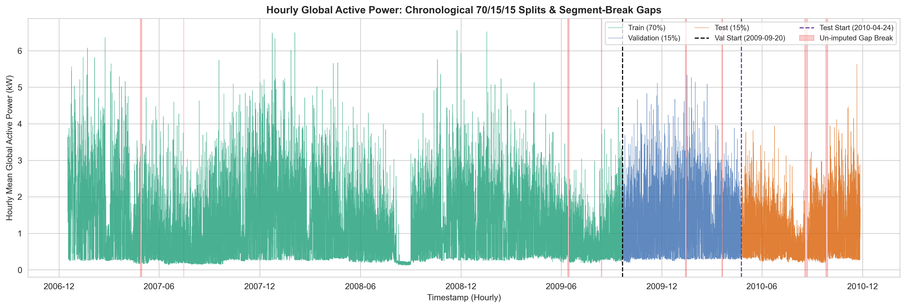
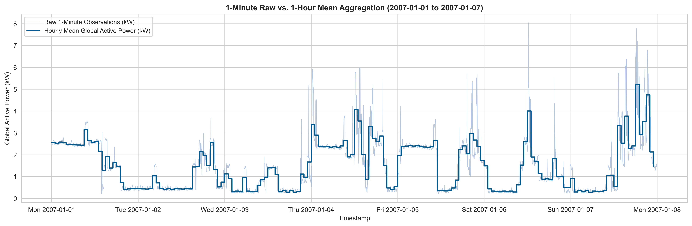
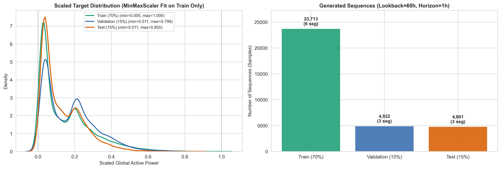

# Laporan Preprocessing Data — Stacked LSTM Household Electric Power Consumption

**Tanggal:** 2026-11-25  
**Skrip Pipeline:** `src/preprocess.py` | **Metadata Terukur:** `data/processed/preprocessing_metadata.json`  
**Status Validasi Otomatis:** **LULUS (`all_passed: True`)**

---

## 1. Konfigurasi Preprocessing & Definisi Target

- **Resolusi Waktu:** Agregasi **1 Jam (`1h`)** dari data sensor mentah 1-menit.
- **Definisi Target Forecasting:** Target prediksi model adalah **konsumsi daya aktif rata-rata rumah tangga (`Global_active_power`, satuan kW) pada 1 jam berikutnya** (yaitu rata-rata pada interval jam $t+1$ setelah jendela masukan berakhir pada jam $t$), **bukan** nilai pada menit berikutnya.
- **Lookback Window:** **`60` time steps** (`60 jam` / 2,5 hari historis).
- **Forecast Horizon:** **`1` time step** (`1 jam` ke depan).
- **Pendekatan:** *Multivariate Time Series Regression* menggunakan `13` fitur input.

---

## 2. Seleksi & Rekayasa Fitur (13 Fitur Input)

Seluruh sequence masukan `X` memiliki bentuk `(N, 60, 13)` dengan urutan fitur berikut:

| Indeks | Nama Fitur | Tipe / Sumber | Agregasi dari 1-Menit | Scaling | Keterangan |
| :---: | :--- | :--- | :--- | :--- | :--- |
| `0` | `Global_active_power` | Sensor (Target & Lag) | `mean` per jam (kW) | `MinMaxScaler(0, 1)` | Daya aktif rata-rata per jam |
| `1` | `Global_reactive_power` | Sensor | `mean` per jam (kVAR/kW) | `MinMaxScaler(0, 1)` | Daya reaktif rata-rata per jam |
| `2` | `Voltage` | Sensor | `mean` per jam (V) | `MinMaxScaler(0, 1)` | Tegangan listrik rata-rata per jam |
| `3` | `Sub_metering_1` | Sensor (Dapur) | `mean * 60` (Wh/jam) | `MinMaxScaler(0, 1)` | Energi dapur per jam (unbiased untuk $\ge 45/60$ menit) |
| `4` | `Sub_metering_2` | Sensor (Laundry) | `mean * 60` (Wh/jam) | `MinMaxScaler(0, 1)` | Energi laundry per jam |
| `5` | `Sub_metering_3` | Sensor (AC & Water Heater) | `mean * 60` (Wh/jam) | `MinMaxScaler(0, 1)` | Energi pemanas air & pendingin per jam |
| `6–7` | `hour_sin`, `hour_cos` | Siklikal Jam (`0–23`) | Deterministik dari timestamp | Alami `[-1, 1]` | Menangkap siklus harian (*diurnal*) |
| `8–9` | `dow_sin`, `dow_cos` | Siklikal Hari (`0–6`) | Deterministik dari timestamp | Alami `[-1, 1]` | Menangkap siklus mingguan |
| `10–11` | `month_sin`, `month_cos` | Siklikal Bulan (`1–12`) | Deterministik dari timestamp | Alami `[-1, 1]` | Menangkap musiman tahunan |
| `12` | `is_weekend` | Biner Akhir Pekan | Deterministik (`Sabtu/Minggu = 1`) | Alami `{0, 1}` | Membedakan profil akhir pekan vs hari kerja |

### Alasan Pengecualian `Global_intensity`
Fitur `Global_intensity` **tidak disertakan** pada eksperimen utama karena dari hasil EDA awal terbukti memiliki korelasi hampir sempurna terhadap target `Global_active_power` (**Pearson $r = 0,9989$**, **Spearman $\rho = 0,9954$**, relasi fisik $P \approx V \cdot I \cdot \cos\phi$). Memasukkan `Global_intensity` bersama `Global_active_power` berisiko menimbulkan multikolinearitas tinggi dan redundansi representasi fitur pada layer LSTM awal tanpa menambah informasi prediktif baru yang signifikan.

---

## 3. Penanganan Missing Values, Agregasi Hourly, & Segmentasi Gap

1. **Standardisasi Token Missing:** Nilai `'?'` pada 6 kolom sensor pertama dan field kosong `""` pada `Sub_metering_3` dikonversi seragam menjadi `NaN`.
2. **Agregasi Hourly dengan Syarat Minimum `45/60` Menit Valid:**
   - Dari **`2.075.259`** observasi mentah 1-menit (`2.049.280` valid; `25.979` missing = `1,2518%`), terbentuk **`34.589`** interval 1-jam awal (`34.151` jam memiliki $\ge 45$ menit valid, `438` jam memiliki $< 45$ menit valid).
   - Dua jam parsial di batas paling awal dan akhir dataset (`2006-12-16 17:00:00` dengan 36 menit valid dan `2010-11-26 21:00:00` dengan 3 menit valid) dipangkas sehingga tersisa **`34.587` slot jam lengkap** dari `2006-12-16 18:00:00` s.d. `2010-11-26 20:00:00` (`436` jam invalid interior).
3. **Interpolasi Terbatas Gap Pendek ($\le 60$ Menit) Secara Lokal per Split:**
   - Setelah pembagian kronologis `70/15/15`, interpolasi linear berbasis waktu (`method='time'`) diterapkan **hanya** pada slot 1-jam terisolasi di dalam split yang memiliki durasi outage mentah $\le 60$ menit.
   - Sebanyak **`5` jam** diinterpolasi pada **Train** (`2007-06-09 18:00`, `2007-08-01 08:00`, `2008-10-25 10:00`, `2009-02-01 16:00`, `2009-02-17 10:00`), sedangkan **Validation (`0`)** dan **Test (`0`)** tidak memerlukan interpolasi.
   - Slot 1-jam `2008-12-10 11:00:00` **sengaja tidak diinterpolasi** karena berasal dari outage sensor mentah berdurasi **`70 menit`** (`10:48–11:57`, melebihi batas maksimum `60 menit`).
4. **Pemutus Segmen untuk Gap Panjang:**
   - Seluruh **`431` jam invalid tersisa** (9 blok gap, mulai dari 70 menit hingga 121 jam / 5 hari) dibiarkan sebagai `NaN` pemutus segmen (*segment break*).
   - Total jam valid siap pakai setelah preprocessing: **`34.156` jam** yang terbagi ke dalam **`12` segmen kontigu** (`6` di Train, `3` di Validation, `3` di Test), dengan panjang segmen terkecil `798` jam (jauh di atas syarat minimum `61` jam, sehingga `0` segmen terbuang).

---

## 4. Pembagian Kronologis, Scaling Tanpa Data Leakage, & Jumlah Sequence

Pembagian dilakukan **secara kronologis ketat tanpa shuffle** dengan proporsi `70% / 15% / 15%`. `MinMaxScaler(feature_range=(0, 1))` di-fit **hanya pada `24.073` baris valid di Train** (`Global_active_power` min `0,124000 kW`, max `6,560533 kW`), lalu diterapkan dengan `.transform()` ke Validation dan Test.

| Split | Rentang Waktu | Total Jam | Jam Valid | Diinterpolasi | Sisa Gap (Pemutus Segmen) | Jumlah Segmen Kontigu | Jumlah Sequence (`lookback=60h, horizon=1h`) | Bentuk `X` (`float32`) | Bentuk `y` (`float32`) |
| :--- | :--- | ---: | ---: | ---: | ---: | ---: | ---: | :--- | :--- |
| **Train (70%)** | `2006-12-16 18:00` – `2009-09-20 11:00` | 24.210 | 24.073 | 5 | 137 | 6 | **23.713** | `(23713, 60, 13)` | `(23713, 1)` |
| **Validation (15%)** | `2009-09-20 12:00` – `2010-04-24 15:00` | 5.188 | 5.102 | 0 | 86 | 3 | **4.922** | `(4922, 60, 13)` | `(4922, 1)` |
| **Test (15%)** | `2010-04-24 16:00` – `2010-11-26 20:00` | 5.189 | 4.981 | 0 | 208 | 3 | **4.801** | `(4801, 60, 13)` | `(4801, 1)` |
| **Total** | `2006-12-16 18:00` – `2010-11-26 20:00` | **34.587** | **34.156** | **5** | **431** | **12** | **33.436** | — | — |

Setiap berkas `.npz` menyimpan `X`, `y_scaled`, `y_raw_kw` (satuan asli kW), `window_start_ts`, `target_ts`, dan `segment_id`.

---

## 5. Hasil Validasi Otomatis

Seluruh pemeriksaan otomatis di dalam `src/preprocess.py` telah dieksekusi dan lulus (`all_passed: True`):

| Pemeriksaan | Status | Hasil Verifikasi Terukur |
| :--- | :---: | :--- |
| **1. Tidak ada sequence melewati gap** | **LULUS** | Seluruh `33.436` sequence memiliki selisih waktu tepat `60 jam` (`216.000 detik`) dari awal jendela ke target, seluruh timestamp dalam `segment_id` valid yang sama, dan bebas `NaN`/`Inf`. |
| **2. Urutan waktu tetap kronologis** | **LULUS** | `window_start_ts` dan `target_ts` naik ketat di tiap split, serta `train_last_target < val_first_start` dan `val_last_target < test_first_start`. |
| **3. Tidak ada data leakage** | **LULUS** | `feature_scaler` & `target_scaler` di-fit tepat pada `24.073` baris valid Train (`data_min_` & `data_max_` cocok presisi `< 1e-9`), interpolasi dilakukan lokal di interior split (Val `0`, Test `0`). |
| **4. Dimensi & rentang input konsisten** | **LULUS** | Seluruh `X` berdimensi `(N, 60, 13)` bertipe `float32`; fitur siklikal pada `[-1, 1]`; `is_weekend` pada `{0, 1}`; fitur kontinu Train `[0.0, 1.0]`, Val `[-0.0108, 0.9951]`, Test `[-0.0027, 1.0538]`. |
| **5. Dimensi target & inverse scaling kW** | **LULUS** | `y_scaled` & `y_raw_kw` berdimensi `(N, 1)` `float32`; galat maksimum `target_scaler.inverse_transform(y_scaled)` terhadap `y_raw_kw` hanya `4,77 × 10^-7 kW` (`< 1e-5 kW`). |
| **6. Integritas data mentah** | **LULUS** | SHA-256 `data/raw/household_power_consumption.txt` tetap `4259c9d7ece5dbee9ab8d53682baac68d791c864f0f64a52b4043cb3b90894b7`. |

---

## 6. Visualisasi Hasil Preprocessing

1. **Split Kronologis Hourly & Gap Pemutus Segmen** — `reports/figures/07_preprocessing_hourly_splits_and_gaps.png`  
   

2. **Perbandingan Data Mentah 1-Menit vs. Agregasi Mean 1-Jam** — `reports/figures/08_preprocessing_1min_vs_hourly_comparison.png`  
   

3. **Distribusi Target Terskala & Jumlah Sequence per Split** — `reports/figures/09_preprocessing_scaling_and_sequences.png`  
   

---

## 7. Rekomendasi Sebelum Tahap Modeling / Training Stacked LSTM

1. **Tetapkan Baseline Wajib Sebelum Melatih Stacked LSTM:**
   - Hitung metrik **Persistence Baseline** ($\hat{y}_{t+1} = y_t$, beban jam sebelumnya) dan **Seasonal Naive 24-Jam** ($\hat{y}_{t+1} = y_{t-23}$, beban jam yang sama kemarin) pada Validation dan Test dalam satuan asli **kW** (`MAE`, `MSE`, `RMSE`, `R²`). Model Stacked LSTM harus terbukti mengalahkan kedua baseline ini.
2. **Arsitektur Stacked LSTM Efisien untuk CPU-Only (`i5-1235U`):**
   - Mulai dengan arsitektur kompak 2-layer Stacked LSTM (mengacu pada pola `tensorflow/SKILL.md`), misalnya: `Input(shape=(60, 13))` → `LSTM(64, return_sequences=True)` → `Dropout(0.2)` → `LSTM(32)` → `Dropout(0.2)` → `Dense(16, activation='relu')` → `Dense(1)` (aktivasi linear untuk target regresi yang tidak dibatasi kaku di Test).
   - Ukuran `23.713` sequence pada CPU dengan batch size `64` (~`371` batch/epoch) akan berjalan sangat cepat per epoch (~5–15 detik/epoch), memungkinkan eksperimen yang iteratif.
3. **Loss, Optimizer, & Callbacks:**
   - Gunakan optimizer `Adam(learning_rate=1e-3)` dengan *gradient clipping* (`clipnorm=1.0`) untuk stabilitas RNN, serta uji `loss='mse'` (atau `Huber` bila ingin lebih tahan terhadap lonjakan puncak beban rumah tangga).
   - Gunakan `EarlyStopping(monitor='val_loss', patience=8, restore_best_weights=True)`, `ModelCheckpoint(..., save_best_only=True)`, dan `ReduceLROnPlateau(monitor='val_loss', factor=0.5, patience=4)`.
4. **Evaluasi Akhir dalam Satuan Asli kW:**
   - Simpan `y_pred_scaled`, lakukan `target_scaler.inverse_transform(y_pred_scaled)` menggunakan `data/processed/scalers/target_scaler.joblib`, lalu hitung **MAE**, **MSE**, **RMSE**, **MAPE** (atau **sMAPE**), dan **$R^2$** terhadap `y_raw_kw`.
